<div align="center">

<a href="https://12345.firetable.tech" target="_blank">
  
</a>

# 民声智理 · 12345 市民热线多频工单 AI 智能研判与主动治理系统
### CivicPulse 12345 · Cognitive Dispatch, Closed-Loop Intake & AI Governance Platform

**快慢双系统协同驱动基层减负 · 3D 数字人语音受理 · L1/L2/L3 主动治理与 48h 假闭环狙击 · 同镜像双域名多租户隔离**

<p align="center">
  <a href="https://12345.firetable.tech" target="_blank">
    
  </a>
  <a href="https://ecom.firetable.tech" target="_blank">
    
  </a>
  <a href="https://github.com/FireTable/12345" target="_blank">
    
  </a>
  <a href="docs/DEPLOY.md">
    
  </a>
</p>

<p align="center">
  <a href="#1-civicsystem-one-12345-政务工单神经级快思考极速定性引擎">
    
  </a>
  <a href="#2-civicsystem-two-慢思考通用认知大模型引擎">
    
  </a>
  <a href="#3-civicanonymizer-全要素可逆脱敏引擎与实体回填状态机">
    
  </a>
  <a href="#4-civicembed-高可靠工单向量嵌入与多节点容灾客户端">
    
  </a>
</p>

<p align="center">
  
  
  
  
  
  
  
</p>

**[🌐 政务 12345 主站](https://12345.firetable.tech)** &nbsp;&bull;&nbsp;
**[🛒 电商客诉示范站](https://ecom.firetable.tech)** &nbsp;&bull;&nbsp;
**[🔄 全链路治理闭环](#-全链路智能治理闭环-end-to-end-closed-loop-capabilities)** &nbsp;&bull;&nbsp;
**[🎬 系统全景宣传片](public/videos/民声智理_总览片_v1.mp4)** &nbsp;&bull;&nbsp;
**[📖 部署运维手册](docs/DEPLOY.md)**

---

</div>

> **💡 双域名独立生产部署（同镜像 `ticket-radar:v0.1.7` 双容器运行）**：
> - **政务 12345 主站**：[https://12345.firetable.tech](https://12345.firetable.tech)（容器 `12345-app`，`APP_DOMAIN=GOV_12345`）
>   - 预置示范站点：**广州市·天河区**（约 **10.6 万**条 / 106,543 条工单、21 街道）、**佛山市·顺德区**（约 **13.8 万**条 / 138,704 条工单、10 镇街）
> - **跨行业电商客诉示范站**：[https://ecom.firetable.tech](https://ecom.firetable.tech)（容器 `12345-ecom-app`，`APP_DOMAIN=ECOMMERCE_CS`）
>   - 预置示范站点：**电商售后客诉中心**（**3,240** 条全渠道客诉 / **40** 个专题 / 8 渠道 × 7 分类），直观验证同一认知治理内核零改代码跨行业迁移能力
> - **在线体验方式**：访问任意站点 `/login` 可在 2 秒内自助注册普通市民/买家账号体验 `/submit` 对话受理与进度闭环（RBAC 权限隔离，普通账号仅访问受理端）；本地开发初始化账号见下方 [3 步极速本地运行](#-3-步极速本地运行-quick-start)。

---

## 🏙️ 核心政务痛点与破局之道 (Pain Points & Solutions)

市民服务热线 12345（以及高并发电商售后客诉中心）是感知民生与服务痛点的“第一哨所”。在实际一线运转中，传统工单模式长期面临**六大顽疾**：

```text
┌──────────────────────────────────────────────────────────────────────────────────────────┐
│                                 传统模式痛点 vs 民声智理破局之道                           │
├──────────────────────────────┬───────────────────────────────────────────────────────────┤
│ 1. 填报门槛高、缺资料难派单   │ 【传统】表单冗长、市民描述碎片化，坐席需逐单回拨补问门牌   │
│                              │ 【破局】🎙️ 3D 数字人语音受理 + 缺资料索引筛查 + Agent 外呼补全│
├──────────────────────────────┼───────────────────────────────────────────────────────────┤
│ 2. 工单洪流与算力爆炸        │ 【传统】人工逐单研判耗时，全量直调大模型成本高、时延数秒   │
│                              │ 【破局】⚡ System-1 4-Head ONNX 0.079ms 初筛，省 80%+ 算力  │
├──────────────────────────────┼───────────────────────────────────────────────────────────┤
│ 3. 多频群诉“同案不同词”      │ 【传统】同地不同名、同案不同写，粗暴关键词导致大量误并漏网 │
│                              │ 【破局】🔍 BGE-M3 向量 + 微观空间基底提纯，跨街区误聚率 0.0%│
├──────────────────────────────┼───────────────────────────────────────────────────────────┤
│ 4. “假闭环”与 AI 越权失控    │ 【传统】表面按时办结实则未解；AI 直接乱派单带来治理红线风险 │
│                              │ 【破局】🚨 48h 满意度回访+假闭环重开 + L1/L2/L3 分级熔断治理│
├──────────────────────────────┼───────────────────────────────────────────────────────────┤
│ 5. 公民隐私外泄与模型幻觉    │ 【传统】原文直传云端模型有隐私风险，地名机构易产生幻觉臆造 │
│                              │ 【破局】🔒 3 层出网 PII 脱敏防火墙 + 法定白名单与别名知识库 │
├──────────────────────────────┼───────────────────────────────────────────────────────────┤
│ 6. 跨城市迁移与跨行业壁垒    │ 【传统】单站点硬编码强绑定，切换城市或业务线需数周二次开发 │
│                              │ 【破局】🌐 PG Schema 隔离 + AI Scout 30s 拓荒 + APP_DOMAIN 双域│
└──────────────────────────────┴───────────────────────────────────────────────────────────┘
```

---

## 🔄 全链路智能治理闭环 (End-to-End Closed-Loop Capabilities)

民声智理已从“单点分析看板”演进为覆盖 **前端受理 → 缺资料补全 → 多频研判 → 分级治理 → 回访防假闭环 → 副驾驶决策** 的完整闭环平台：

### 1. 🎙️ 市民/买家智能受理门户 (`/submit`)
- **3D 数字人「小蠢」+ 流式语音对话**：集成 [`@firetable/project-xiaochun`](package.json) 3D 交互数字人与 [`@firetable/stream-asr`](package.json) 流式语音识别，通过统一 `VoiceChatComposer` 支持边说边转写，开启麦克风自动打断数字人播报防回声；同步保留传统表单切换。
- **自动结构化建单与隐私脱敏**：多轮对话自动抽取事由、分类、辖区/渠道、涉事主体与地点并动态追问缺项；手机号/身份证/邮箱等敏感信息经 `@civic/anonymizer` 自动打码保护。
- **底部实时进度追踪与市民端重开**：提交后在页底「我的投诉/客诉进度」实时查看 4 态处置节点；已办结工单支持市民/买家一键点击 **「未解决，申请重开」**，直达后台假闭环督办队列。

### 2. 📑 工单中心：4 态统一流转与缺资料 Agent 补全 (`/tickets`)
- **4 态统一状态机**：全站统一收敛为 `PENDING（待派单）→ DISPATCHED（已派单）→ IN_PROGRESS（处理中）→ RESOLVED（已办结）`，重开工单（`REOPENED`）与疑似假闭环单自动置顶优先督办。
- **「缺资料」Tab + 一键让 Agent 跟进**：数据库由 `is_missing_info` 触发器持久化列实时标记缺失位置、涉事主体或电商短地址（`char_length <= 6`）的未办结工单；工作人员点击 **「Agent 跟进」** 即可拉起 `VoiceOutreachDialog` 语音外呼补全要素，自动回写工单字段并记入处置时间轴。
- **「疑似假闭环」与「待人工复核」**：集中处置复发重开工单与低置信度异常抽取件，人工纠偏结果自动沉淀为辖区别名知识。

### 3. 🛡️ 智能治理中心：L1 / L2 / L3 分级自治与 48h 回访 (`/agent`)
- **三级权限边界（Autonomy Levels，`lib/agent-governance.ts`）**：
  - **L1 自动执行 (`L1_AUTO`)**：覆盖双域多频专题超期催办（`SLA_OVERDUE`）与电商低风险缺资料补全（`MISSING_INFO`），自动触发并写入处置台账；
  - **L2 人工审批 (`L2_APPROVAL`)**：覆盖政务缺资料语音核实（`MISSING_INFO`）、双域 48h 满意度回访/假闭环重开（`REOPEN_CALLBACK`）及 Copilot `civic-action` 派单/升级/办结提案，仅生成草稿，必须由人工点击审批通过后生效；
  - **L3 红线熔断 (`L3_BLOCKED`)**：命中 11 类政务涉稳/重大安全险情或电商食安/12315 监管/社媒舆情红线（`REDLINE_BLOCK`）时强制熔断，严禁 AI 自动外联，直接移交人工专班接管。
- **48h 满意度回访 (`REOPEN_CALLBACK`)**：对已办结专题/工单发起 48 小时语音回访（L2 人工审批确认触发），一旦识别诉求人反馈未解决，当场判定 **疑似假闭环** 并重开升级。
- **每日/专题治理专报**：一键汇总态势指标、重点镇街/渠道压力与风险清单，支持规范表格渲染与导出。

### 4. 🤖 AI 研判副驾驶 (`LightCopilot`)
- **1 轮并行预取极速简报**：命中简报类提问（`isBriefingPrefetchPrompt`）时，服务端并行预取 `region_overview`、`search_themes`、`list_townships` 三路脱敏汇总，单轮大模型调用即秒级流式吐出完整研判简报。
- **3 层出网 PII 脱敏防火墙**：
  1. 会话输入与只读工具返回值统一经 `@civic/anonymizer` 可逆脱敏；
  2. `backend/agent/copilot-agent.ts` 每次送模前强制执行 `sanitizeMessagesForModel`；
  3. 触发云端灾备时，`CloudOpenAIAdapter` 执行末公里 `scrubCloudPiiText` 兜底清洗身份证、银行卡、电话与邮箱。
- **可执行提案卡片 (`civic-action`)**：Copilot 工具层严格只读不写库；涉及派单/升级/办结/重开（`DISPATCH`/`ESCALATE`/`RESOLVE`/`REOPEN`/`ADVANCE`）时仅输出结构化提案卡片，由工作人员显式点击确认后落库。
- **规范表格与一键导出**：内置 GFM 宽表横向滚动容器与一键 **导出 Markdown**，支持语音对话与 3D 数字人联动。

### 5. 🌐 全景页面路由与开放生态 (Route & Protocol Matrix)

| 路由 / 端点 | 模块名称 | 核心能力与定位 |
| :--- | :--- | :--- |
| `/` | 数据总览态势大盘 | 辖区天地图热力 / 电商仓网矩阵、核心 KPI、顶部 React Flow AI 研判流水线抽屉 |
| `/submit` | 市民/买家受理门户 | 3D 数字人「小蠢」+ 语音转写对话建单、隐私脱敏、底部实时进度与重开申诉 |
| `/tickets` | 工单中心 | 4 态统一流转、`缺资料` + Agent 外呼补全、`疑似假闭环`、`待人工复核` |
| `/agent` | 智能治理中心 | L1 自动执行 / L2 人工审批 / L3 红线熔断、48h 满意度回访与治理专报 |
| `/themes` | 多频工单看板 | 同案同地群诉 / 同 SKU 客诉聚类列表、实体拓扑图谱与公文级处置预案 |
| `/multifreq` | 工单透势研判 | 紧急×重要四象限透视、天地图测绘热力、办结后复发假闭环风险雷达 |
| `/screen` | 指挥调度大屏 | 4K/8K 城市运行管理中心（IOC）全景实时驾驶舱 |
| `/dict` | 标准字典治理 | 法定镇街/社区白名单树、5,600+ 政务别名自学习知识库 |
| `/sandbox` | 实时 X-Ray 演练沙箱 | 端到端实时观测 PII 脱敏、System-1 定性、要素抽取与假闭环撞库预览 |
| `/admin/regions` | 多租户与算力管理 | PostgreSQL `region_{id}` Schema 隔离、AI Scout 30s 拓荒、Colab GPU 热挂载、MCP 授权 |
| `/login` | 统一认证门户 | Better Auth 登录与市民/买家 2 秒自助注册（RBAC 双角色隔离） |
| `POST /api/mcp` | MCP Server | 遵循 Model Context Protocol (`2025-03-26`)，暴露 `list_regions`、`push_ticket`、`region_overview` |

---

## 📦 自研四大核心内核套件矩阵 (Core Proprietary Packages)

为了支撑十万级工单毫秒级吞吐、端侧数据不出域与确定性可逆回填，本项目在 `packages/` 目录下自研了 **四大认知与安全内核套件**：

```text
+--------------------------------------------------------------------------------------------------------------------+
|                                    民声智理 · 自研四大核心内核套件协同架构                                           |
+--------------------------------------------------------------------------------------------------------------------+
| 📥 原始市民/买家工单 (文本 / 语音转写)                                                                              |
|    ↓                                                                                                               |
| 🔒 [@civic/anonymizer] (6 类 PII 可逆脱敏) ──→ 13μs 国标校验脱敏，生成 Session Keymap，公民隐私留存本地专网         |
|    ↓ (Masked Text)                                                                                                 |
| ⚡ [@civic/system-one] (快思考轻量决策) ──→ 4-Head Cross-Attention (4.5MB ONNX, 0.079ms, 12,664 TPS) + 11 类红线    |
|    ├── 意图判别 (99.75%) | 紧迫等级 (99.84%) | 涉稳护栏 (99.86% 0漏报) | 法定领域单一/联合分派 (99.35%)            |
|    ↓                                                                                                               |
| 🧬 [@civic/embed] (高可靠向量嵌入客户端) ──→ BAAI/bge-m3 多端点最少连接负载均衡与自动熔断转移，生成时空共性向量        |
|    ↓ (微观实体提纯 & 空间网格对齐)                                                                                  |
| 🧠 [@civic/system-two] (慢思考通用大模型) ──→ Metal 27B / Colab GPU / 云端容灾 (流式 + CoT 分离 + 云端 PII 兜底)    |
|    ↓ (结构化抽取结果)                                                                                               |
| 🔄 [@civic/anonymizer] (实体反向回填) ──→ O(1) 深度原型安全无损还原真实实体，持久化至独立 Schema 数据库              |
+--------------------------------------------------------------------------------------------------------------------+
```

### 1. `@civic/system-one`：12345 政务工单神经级快思考极速定性引擎
> 详阅：[`packages/civic-system-one/README.md`](packages/civic-system-one/README.md)

- **极速低时延与万级吞吐**：4 头交叉注意力双流 ONNX 模型（体积 **4.5 MB**），通过 `onnxruntime-node` 原生内嵌于 Node.js（零外部 Python 进程依赖），单条纯前向推理耗时仅 **0.079 ms**（较通用 ModernBERT-large 提速 **1,110 倍**），吞吐达 **12,664.9 TPS**。
- **12,828 条全盲工单评测**：涉稳护栏 **99.86%（0 漏报）**、紧迫等级 **99.84%**、诉求意图 **99.75%**、法定领域协同池 **99.35%**。
- **11 类涉稳硬红线符号互锁 (`src/redline.ts`)**：内置 `matchCivicRedline` / `hasCivicRedlineSignal`，覆盖自杀自残、极端暴力、涉黑涉恶、越级上访、群体聚集、堵路堵门、集体罢工、重大安全事故、群体食安中毒、重大舆情曝光与极端威胁，配合 16 字否定/预防/良性语境窗口精准防误杀。

### 2. `@civic/system-two`：慢思考通用认知大模型引擎
> 详阅：[`packages/civic-system-two/README.md`](packages/civic-system-two/README.md)

- **OpenAI 兼容 + 流式与 CoT 分离**：完整支持 `chat.completions.create`、`chat.completions.createStream` 与 Zod 强类型 `createJSON<T>`，默认支持思维链（`reasoning_content`）与纯正文分离，结构化抽取显式关闭思考加速直出。
- **多节点异构算力池与自愈切回**：本地及远程默认搭载 **Ternary Bonsai 2.5 27B**（Apple Silicon Metal 运行 `Ternary-Bonsai-2.5-27B-PQ2_0-mtp.gguf` + MTP 投机解码达 **~27–29 tok/s**；Windows RTX 3080 / Linux / Colab CUDA 通过 `ninfer-serve` 运行 `Ternary-Bonsai-2.5-27B-PQ2_0-ninfer-v3.ninfer`，`--model-id bonsai-2-27b`，支持 32K+ 上下文），支持通过 `SYSTEM_TWO_CONCURRENCY` 释放并发（如 RTX 3080 `--max-concurrency 2` 设 `2`，Colab L4/A100 设 `4`），并支持 [`scripts/colab`](scripts/colab/README.md) 一键命令行拉起/测试/关停（`pnpm colab:up` / `colab:verify` / `colab:stop`）与云端 OpenAI/DeepSeek 灾备三层降级、30 秒冷却自动探测切回。
- **云端末公里 PII 清洗**：`CloudOpenAIAdapter` 内置 `scrubCloudPiiText`，在任何消息发往外部云端端点前自动拦截清洗身份证、银行卡、手机/固话与电子邮箱。

### 3. `@civic/anonymizer`：全要素可逆脱敏引擎与实体回填状态机
> 详阅：[`packages/civic-anonymizer/README.md`](packages/civic-anonymizer/README.md)

- **6 类政务/客诉敏感要素精准识别**：覆盖二代身份证（ISO 7064:1983.MOD 11-2 国标校验和）、机动车号牌、电子邮箱（优先级 0.92，防止邮箱前缀手机号被误截断）、手机与带区号固话（支持连字符/空格分隔，屏蔽超长流水号）、私密室内房号、自然人姓名（屏蔽群体泛词）；同时保留行政区划、街道社区与公共商户门头。
- **微秒级性能与深度安全回填**：12.8 万真实工单抽测均值 **13 微秒/件**（7.5 万单/秒）；`deanonymize()` 采用递归深拷贝 + 单次正则回调替换，免疫 JSON 转义破坏、`$&/$1` 注入、循环引用与 `__proto__` 原型污染，实现 **100.0%** 无损反向还原。

### 4. `@civic/embed`：高可靠工单向量嵌入与多节点容灾客户端
- **多端点最少连接负载均衡**：按各节点在途请求数与连续失败次数动态择优派发，支持 `local:` 本地高速直连与 `cloud:` 云端 429 智能退避双轨容灾。
- **高维语义表征**：标准化接入 `BAAI/bge-m3` 1024 维稠密向量，自适应分批（Bulk 32 / Online 4）。

---

## ⚡ 数据库与接口全链路性能优化实测 (`ticket-radar:v0.1.5` / `9b93585`)

面向十万级多租户真实工单负载，版本 `v0.1.5`（Commit `9b93585`）完成了从 PostgreSQL 索引与内存参数、应用层缓存与认证到边缘代理压缩的全链路深度调优：

### 核心工程优化项
1. **触发器持久化列与覆盖索引（[`db/migrations/0012_perf_indexes.sql`](db/migrations/0012_perf_indexes.sql)）**：
   - 新增 `tickets.is_missing_info` 预计算列 + `BEFORE INSERT/UPDATE` 触发器 + 部分索引 `idx_tickets_missing_info_ct`，彻底消除 `缺资料` 筛选时的全表 POSIX 正则扫描；
   - `tab=pending` 采用三段互斥索引归并分页（`idx_tickets_reopened_updated_at` + `idx_tickets_fake_closure_pending` + `idx_tickets_status_create_time_id_desc`），彻底消除 10 万+ 行 `CASE` 全表排序；
   - 新增统计覆盖索引 `idx_tickets_stats_cover`、关联覆盖索引 `idx_tickets_id_subd_status` 与 `idx_themes_created_at`，配合 `VACUUM ANALYZE` 实现热点查询 **Index-Only Scan（0 磁盘读）**。
2. **SWR 共享缓存与 Better Auth `cookieCache`**：
   - [`lib/civic-cache.ts`](lib/civic-cache.ts)：挂载于 `globalThis` 的共享 LRU 缓存（容量 500，60s 软过期 / 10min 硬过期）与后台单飞 SWR 刷新，写操作按区精准失效（`invalidateCivicAggregates`）；
   - [`lib/auth/config.ts`](lib/auth/config.ts)：启用 Better Auth `session.cookieCache`（5 分钟 HMAC 签名 `session_data` Cookie），鉴权提速 **5.8×**，避免高并发 API 重复回查 `session`/`user` 表。
3. **API 载荷瘦身与边缘分流**：
   - [`app/api/clusters/route.ts`](app/api/clusters/route.ts)：支持服务端分页（`?page=1&size=15&sort=story`）与 `/multifreq` 专用轻量视图（`?view=summary`）及预编码字节缓存，单次响应载荷由原先 **4.14~6.86 MB** 压降至 **未压缩 5.4~7.6 KB / zstd 压缩后 1.3~1.9 KB**（降幅 **99.8%+**）；
   - [`docker-compose.yml`](docker-compose.yml)：`12345-postgres`（`pgvector/pgvector:pg16`，`shm_size: 512m`）配置 `shared_buffers=1GB`、`effective_cache_size=4GB`、`work_mem=32MB`、`maintenance_work_mem=256MB`、`random_page_cost=1.1`、`jit=off`、`max_parallel_workers_per_gather=2`、`checkpoint_completion_target=0.9`；
   - 共享 Caddy 配置 `@streaming`（`/api/sse*`、`/api/copilot*`、`/api/agent/outreach*`、`/api/mcp*` 走 `flush_interval -1` 免压缩实时透传）与常规接口 `encode zstd gzip` 分流。

### VPS 生产库 Before vs After 实测对比（热查）

| 测试场景 | 租户数据规模 | 优化前耗时 | 优化后耗时 | 加速比 / 收益 |
| :--- | :--- | :---: | :---: | :--- |
| `tab=pending` 优先置顶分页 | 天河区 (106,543 行) | 64.55 ms | **0.25 ms** | **258×**（缓冲读取 -99.9%，0 磁盘读） |
| `tab=pending` 优先置顶分页 | 顺德区 (138,704 行) | 73.46 ms | **0.25 ms** | **294×**（缓冲读取 -99.9%，0 磁盘读） |
| `missing_info` 缺资料聚合计数 | 天河区 (106,543 行) | 121.30 ms | **25.44 ms** | **4.8×**（0 磁盘读） |
| `missing_info` 缺资料聚合计数 | 顺德区 (138,704 行) | 337.29 ms | **21.65 ms** | **15.6×**（缓冲 -93%，0 磁盘读） |
| `workorder_stats` 统计面板 | 天河 / 顺德 | 157.51 / 348.88 ms | **54.03 / 63.02 ms** | **2.9× / 5.5×**（Index-Only Scan，0 磁盘读） |
| `GET /api/clusters` 分页 / 摘要 | 天河 / 顺德 / 电商 | 4.14~6.86 MB | **5.4~7.6 KB**（zstd **1.3~1.9 KB**） | **载荷 -99.8%+**，回环热查 **13~21 ms** |
| Better Auth 会话鉴权 | 全站并发 API | 每请求查 DB | 5 min HMAC `cookieCache` | **5.8×** 鉴权提速 |

---

## 📸 核心系统界面与全景研判矩阵 (System Showcase & Visual Matrix)

系统遵循 **Civic Light** 现代政务设计体系，以下核心视窗均在生产环境（`ticket-radar:v0.1.7`）实机捕获（`01`–`09` 为 **4K 3840 × 2160**，`10`–`13` 为 **Retina 2880 × 1800**）；全站每个页面的功能、权限与接口说明详见 **[全站页面功能与界面说明 (docs/PAGES.md)](docs/PAGES.md)**：

### 旗舰总览 · 政企智能调度指挥驾驶舱大屏 (`/screen`)
> 专为城市运行管理中心（IOC）指挥大厅设计，支持 4K/8K 巨幕投屏，集天地图全域民声热力、流式脉冲、AI 研判态势与多维指标于一体。

| 09. 政企智能调度指挥驾驶舱 · 全景数据大屏 (`/screen`) |
| :--- |
| 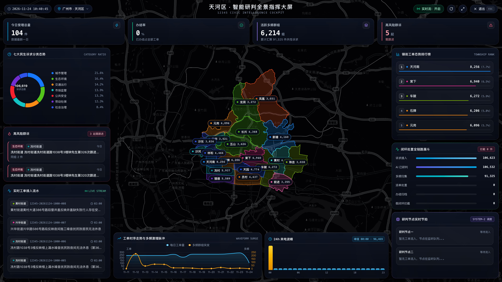 |
| **核心亮点**：深色全屏沉浸式指挥座舱、天地图 CGCS2000 测绘级网格热力图、工单多频脉冲实时滚动、万人诉求率与闭环指标全景联动。 |

### 第一层 · 宏观态势感知与全流程 AI 认知调度中枢

| 01. 数据总览 · 态势感知大盘 (`/`) | 06. AI 研判工厂 · React Flow 认知图谱 (顶部抽屉) |
| :--- | :--- |
| 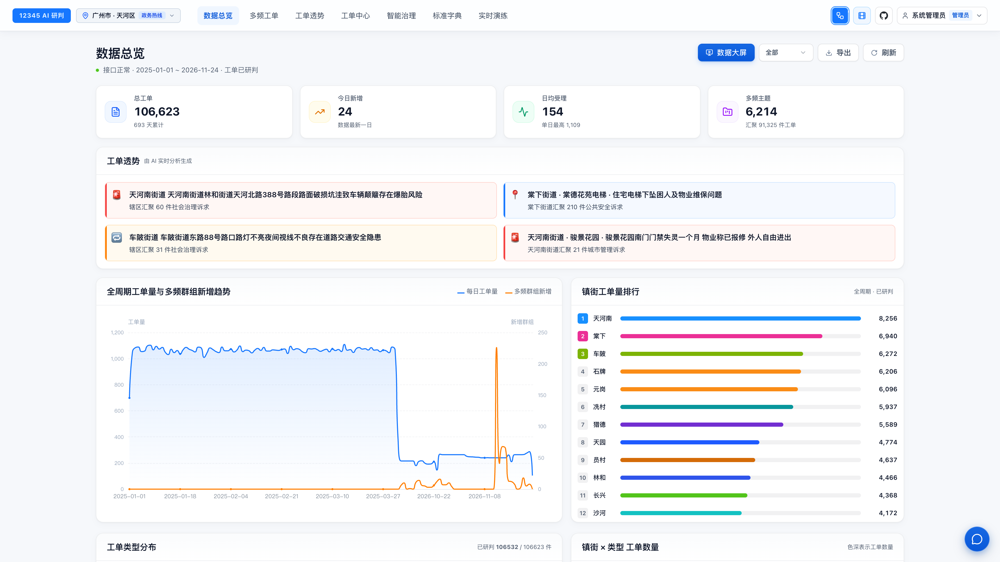 | 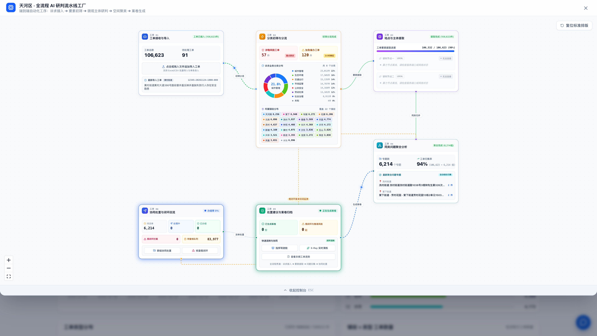 |
| **核心亮点**：辖区法定矢量底图像素级对齐、全量工单/多频聚类/日均负荷 KPI 卡片、分类环形态势图、AI 研判副驾驶入口。 | **核心亮点**：顶部门户集成式 React Flow 流水线抽屉，可视化呈现接入导入、分类初筛、要素提取、同类聚合、案卷生成与第 6 工序协同处置闭环回流。 |

### 第二层 · 深度研判决策：四象限透势与多频群诉案卷

| 02. 工单透势 · 四象限矩阵与假闭环狙击 (`/multifreq`) | 03. 多频工单 · 群诉聚类与公文处置预案 (`/themes`) |
| :--- | :--- |
| 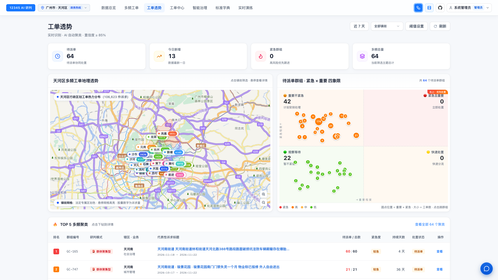 | 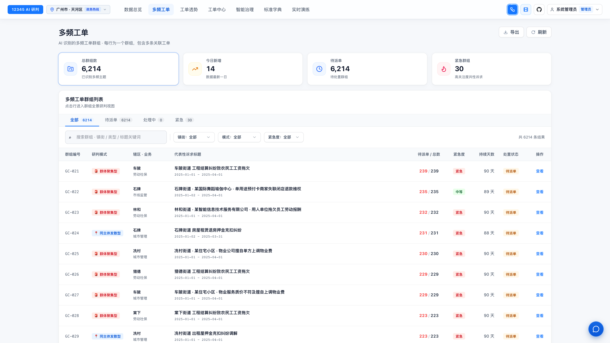 |
| **核心亮点**：紧急×重要四象限透势（`?view=summary` 秒级加载）、天地图测绘热力定位、假闭环时序风险雷达。 | **核心亮点**：严苛“同案同地”实体基底提纯聚类，自动输出含牵头单位、协办职能局与响应时限的公文级处置预案。 |

### 第三层 · 微观数据穿透与政务白名单知识底座

| 04. 工单中心 · 四要素抽取与核查穿透 (`/tickets`) | 05. 标准字典 · 权威白名单与别名自学习演练 (`/dict`) |
| :--- | :--- |
| 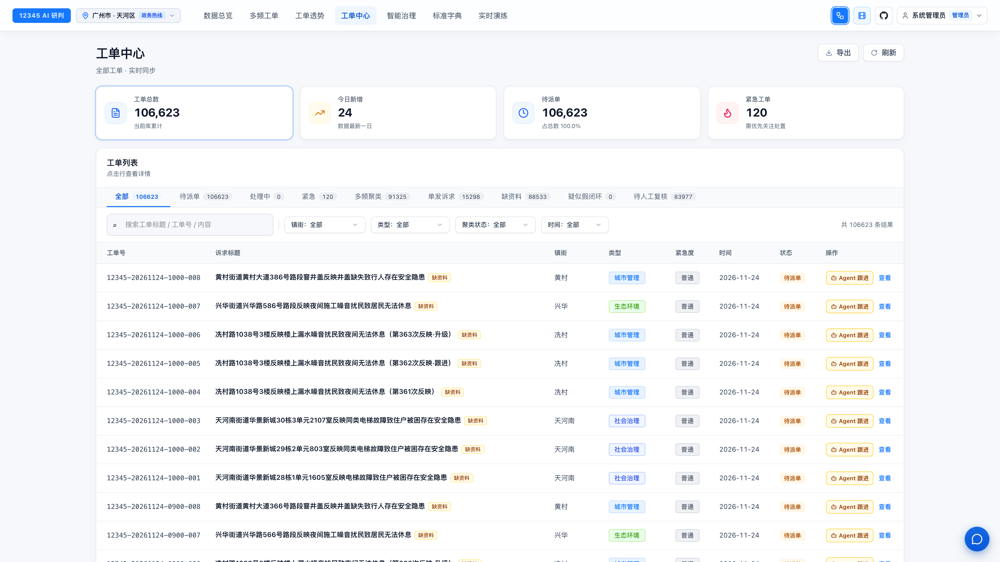 | 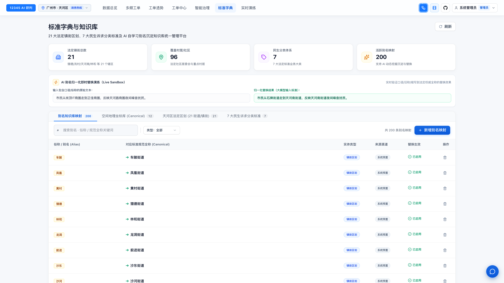 |
| **核心亮点**：十万级全量工单穿透检索、4 态统一流转、`缺资料` 自动筛查与 Agent 语音外呼补全、四要素明细与人工复核标记。 | **核心亮点**：法定镇街/社区网格白名单树、5,600+ 政务别名自学习知识库，配合 `/sandbox` 实时沙箱验证归一化。 |

### 第四层 · 多城市物理级租户隔离与权威认证门户

| 07. 多租户与算力控制台 (`/admin/regions`) | 08. 统一认证门户 (`/login`) |
| :--- | :--- |
| 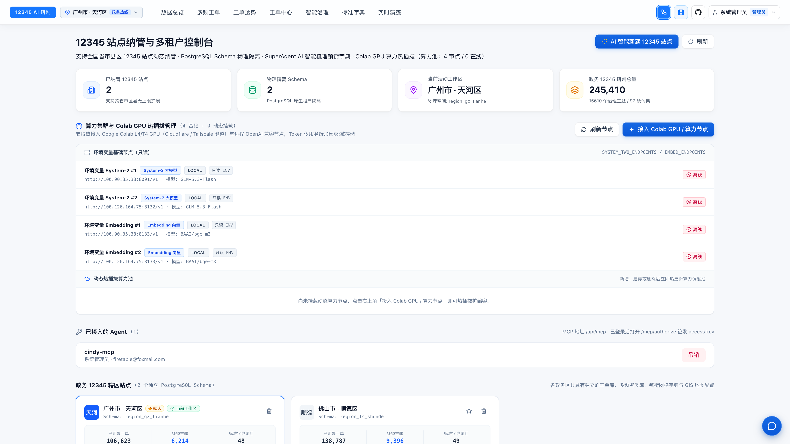 | 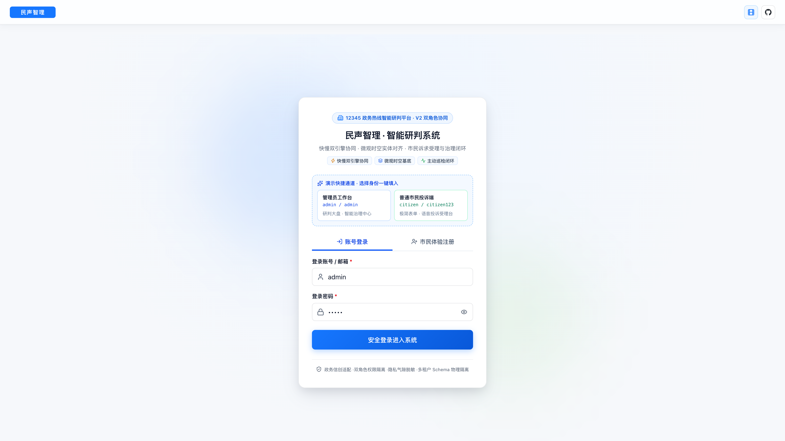 |
| **核心亮点**：PostgreSQL `region_{id}` 物理隔离、SuperAgent AI Scout 30 秒拓荒新辖区、Colab/Linux GPU 算力热挂载与 MCP 密钥管理。 | **核心亮点**：Civic Light 双域自适应登录/注册门户、Better Auth `cookieCache` 会话安全防护与管理端/市民端 RBAC 隔离。 |

### 第五层 · 全链路闭环受理与 L1 / L2 / L3 主动治理中枢

| 10. 市民/买家 3D 语音对话受理门户 (`/submit`) | 11. 智能治理 · L1/L2/L3 分级自治与红线熔断 (`/agent`) |
| :--- | :--- |
| 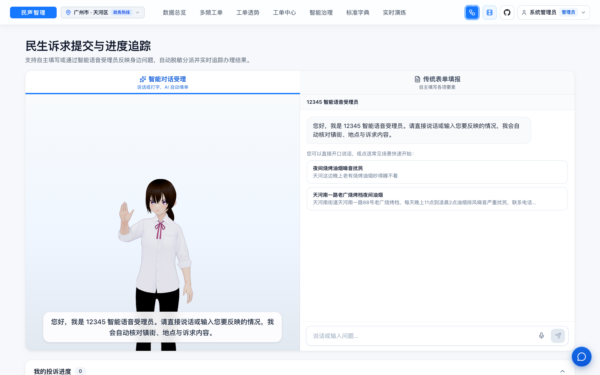 | 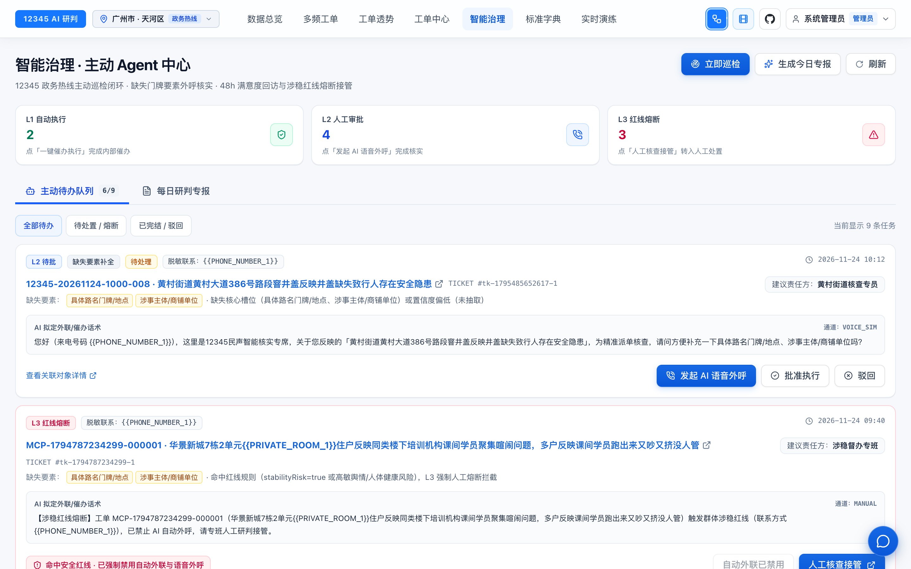 |
| **核心亮点**：3D 数字人「小蠢」+ 流式语音转写对话建单，自动核对镇街、地点与涉事主体并脱敏打码；支持切换传统表单与页底「我的投诉进度」实时追踪及假闭环一键重开。 | **核心亮点**：主动巡检驱动 L1 自动执行 / L2 人工审批 / L3 红线熔断三级分权，命中涉稳或食安红线强制禁用自动外联并转人工专班，全链路展示气隙脱敏占位符并一键生成每日研判专报。 |

### 第六层 · 缺资料 Agent 外呼补全与跨行业电商独立示范站

| 12. 缺资料筛查与 3D 数字人 AI 语音外呼补全 (`/tickets`) | 13. 跨行业电商客诉独立示范站 (`ecom.firetable.tech`) |
| :--- | :--- |
|  | 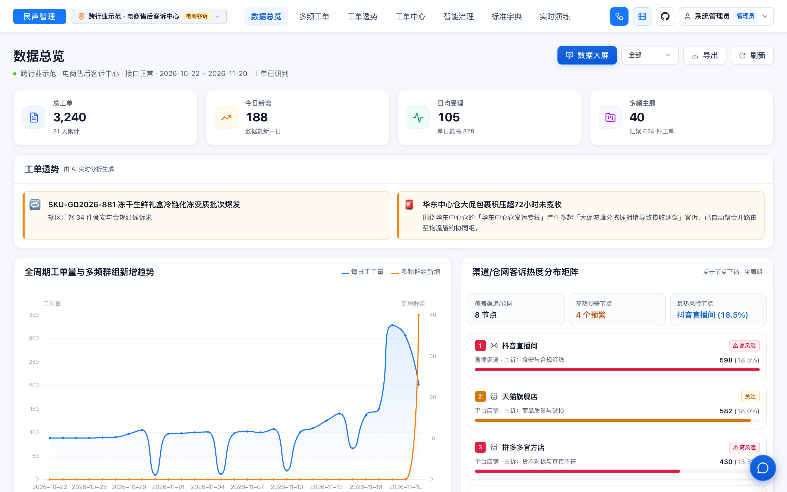 |
| **核心亮点**：触发器部分索引毫秒筛出缺门牌/主体工单，一键拉起 3D 小蠢语音外呼弹窗（气隙脱敏 `{{PHONE_NUMBER_1}}`），补全要素自动回写工单与处置时间轴。 | **核心亮点**：复用同一生产镜像双容器运行（`APP_DOMAIN=ECOMMERCE_CS`），自动切换电商售后客诉中心（3,240 条客诉 / 40 个专题）与全渠道仓网客诉热度分布矩阵。 |

---

## 🎬 系统演示视频专区 (System Demo Videos)

| 演示模块 | 视频文件 (点击观看) | 核心演示内容与研判亮点 |
| :--- | :--- | :--- |
| 🌟 **系统全景总览** | [`民声智理_总览片_v1.mp4`](public/videos/民声智理_总览片_v1.mp4) | **全景总览与产品宣传片**：民声智理整体架构、核心价值、AI 研判闭环与基层赋能成效。 |
| 📊 **数据总览看板** | [`数据总览.mp4`](public/videos/数据总览.mp4) | **首页态势大盘**：辖区热点态势地图、实时工单统计、多维处置率指标与 AI Copilot 交互。 |
| 🗂️ **多频工单看板** | [`多频工单.mp4`](public/videos/多频工单.mp4) | **双轨聚类折叠**：多频主题群组智能聚类、一键折叠详情、实体拓扑与公文级处置建议。 |
| 📈 **工单透势研判** | [`工单透势.mp4`](public/videos/工单透势.mp4) | **四象限与假闭环追踪**：紧急×重要象限图、办结后再反映的假闭环预警与重点督办。 |
| 📑 **工单中心核查** | [`工单中心.mp4`](public/videos/工单中心.mp4) | **全量工单穿透**：高阶复合检索、四要素抽取明细、实体归一化与人工复核流转。 |
| 📖 **标准字典治理** | [`标准字典.mp4`](public/videos/标准字典.mp4) | **知识库与别名沉淀**：多辖区法定镇街/村居白名单、别名自学习沉淀与权威实体对齐管理。 |

---

## 🛠️ 技术栈与架构选型 (Tech Stack)

| 层次 | 技术选型 | 说明与选型收益 |
| :--- | :--- | :--- |
| **全栈应用框架** | **Next.js 15.2 (App Router Standalone) + React 19** | 服务端流式渲染、单镜像双域运行与现代化交互体验 |
| **工作流与智能体** | **LangGraph JS (`@langchain/langgraph`)** | 确定性 DAG 研判流水线与 `LightCopilot` 多工具流式副驾驶 |
| **数字人与语音** | **`@firetable/project-xiaochun` + `@firetable/stream-asr`** | 3D 数字人「小蠢」交互渲染 + 浏览器端流式 ASR 语音识别 |
| **数据库 & ORM** | **PostgreSQL 16 (`pgvector`) + Drizzle ORM** | `region_{id}` 原生 Schema 物理隔离、触发器预计算列与覆盖索引零磁盘读 |
| **GIS 测绘底图** | **Leaflet + 国家天地图 CGCS2000 瓦片** | 消除 GCJ-02 坐标漂移，第四级法定镇街高精矢量面融合 |
| **端侧快思考** | **`@civic/system-one` (4-Head ONNX + 11 类红线)** | 0.079ms / 12,664 TPS 本地极速定性与 99.86% 涉稳拦截 |
| **深度慢思考** | **`@civic/system-two` (Metal 27B / Colab GPU / 云端容灾)** | CoT 分离、流式输出、多节点热挂载与云端末公里 PII 清洗 |
| **数据安全脱敏** | **`@civic/anonymizer` (6 类 PII 可逆脱敏状态机)** | 13μs 国标校验脱敏，配合 Copilot 与云端形成 3 层出网防火墙 |
| **密集语义向量** | **`@civic/embed` (`BAAI/bge-m3` 集群客户端)** | 多端点最少连接负载均衡，云地双轨 429 智能退避与故障转移 |
| **认证与权限** | **Better Auth 1.7 + Drizzle 适配器 + `cookieCache`** | 双角色 RBAC（管理员/市民）、5 分钟 HMAC Cookie 缓存（5.8× 提速） |
| **生态协议** | **Model Context Protocol (`MCP 2025-03-26`)** | 标准 OAuth 发现 + Streamable HTTP，赋能外部 Agent 无缝调用 |

---

## 🚀 3 步极速本地运行 (Quick Start)

### 1. 安装项目依赖
```bash
pnpm install
```

### 2. 配置环境变量与初始化数据库
复制根目录的 [`.env.example`](.env.example) 为 `.env.local`，按需填入 PostgreSQL 连接、`APP_DOMAIN`（`GOV_12345` / `ECOMMERCE_CS` / `ALL`）与模型参数，一键完成迁移与初始化：
```bash
cp .env.example .env.local

# 一键完成表结构迁移、索引创建、示范站点、行政边界、标准字典与默认账号初始化
pnpm db:init
```

### 3. 启动开发服务
```bash
# 轻量模式启动（仅 Next.js，依赖云端/备用 API，无需本地显卡）
pnpm dev:web

# 全栈模式启动（并行拉起 System-2 本地 Metal 推理引擎 8132 + Next.js 3000）
pnpm dev
```

打开 **[http://localhost:3000](http://localhost:3000)** 即可访问：
- **本地开发默认管理员账号**：由 `.env.local` 中 `ADMIN_USERNAME` / `ADMIN_PASSWORD` 指定（`.env.example` 默认 `admin` / `admin`，**生产环境务必覆盖为高强度随机密码**）；
- **本地开发默认市民账号**：由 `CITIZEN_USERNAME` / `CITIZEN_PASSWORD` 指定（`.env.example` 默认 `citizen` / `citizen123`），或直接在 `/login` 注册新市民账号。

---

## 🔧 常用开发与运维指令

| 命令 | 说明 |
| :--- | :--- |
| `pnpm dev:web` | **轻量启动**：仅启动 Next.js 本地开发服务（大模型走云端灾备或已挂载算力池） |
| `pnpm dev` | **全栈启动**：并行拉起 System-2 本地大模型推理引擎 (8132) + Next.js (3000，含内嵌研判 worker) |
| `pnpm dev:models` | **算力集群**：并行拉起 System-2 (8132) + Civic-Embed (8133)，支持通过 Tailscale 供 VPS 跨网调度 |
| `pnpm colab:up` | **一键拉起 Colab GPU**：自动分配 L4 运行 `bonsai-2-27b` + `BAAI/bge-m3`；配置 `CIVIC_COLAB_TUNNEL_TOKEN` 时自动启用 `named` 单域名固定隧道（`https://civic-colab.firetable.tech/v1` + `/embed/v1`，零 URL/Token 复制粘贴），否则回退 Cloudflare Quick Tunnel（支持 `-- --gpu T4\|L4\|A100`、`-- --tunnel auto\|named\|cloudflared\|tailscale`、`-- --public-host <host>`、`-- --show-token`、`-- --session <name>`） |
| `pnpm colab:status` | **Colab 算力状态**：巡检当前 Colab GPU 显存占用与公网/内网隧道端点连通性 |
| `pnpm colab:test` | **Colab 端到端校验**：依次验证 401 鉴权拦截、`/v1/models` 200、流式对话及 1024 维向量嵌入 |
| `pnpm colab:stop` | **关停并销毁 Colab VM**：优雅停服并销毁 Colab 运行时，立即停止计算单元（CU）计费 |
| `pnpm colab:verify` | **全自动拉起与销毁验收**：一键启动 Colab GPU → 执行完整 E2E 校验 → 无论成败自动销毁 VM |
| `pnpm db:init` | **全量一键初始化**：表结构迁移、示范租户、高精天地图边界、全量字典与管理员账号 |
| `pnpm db:migrate` | 执行幂等数据库迁移（含 `0012` 覆盖索引/触发器与 `0013` PII 审计日志表） |
| `pnpm db:init-admin` | 初始化/重置默认管理员账号 |
| `pnpm db:init-tenants` | 初始化/同步多租户站点、行政边界与别名词库 |
| `pnpm db:studio` | 打开 Drizzle Studio 可视化数据管理面板 |
| `pnpm build` | 编译 Next.js Standalone 生产构建 |

---

## 📚 专属文档导航体系 (Documentation)

- 🖥️ **[全站页面功能与界面说明 (PAGES.md)](docs/PAGES.md)**：逐页拆解全站 15 个路由与 2 个全局抽屉的权限、交互模块、关联接口、双域差异与实机截图。
- 🚀 **[系统生产部署与运维手册 (DEPLOY.md)](docs/DEPLOY.md)**：覆盖本地开发、双域名 Docker Compose 容器化编排（`12345-app` + `12345-ecom-app`）与纯离线私有化部署。
- 📐 **[AI 研判认知工作流规范 (WORKFLOW.md)](docs/WORKFLOW.md)**：System-1/2 双系统图状态机、同案同地判准、向量嵌入与主动治理闭环规范。
- 🗺️ **[空间地理与天地图 GIS 规范 (SPATIAL.md)](docs/SPATIAL.md)**：天地图 CGCS2000 测绘级底图无偏移对齐、四级镇街矢量面与时空核心提纯标准。
- 🔌 **[Model Context Protocol 接入指南 (MCP.md)](docs/MCP.md)**：外部智能体通过 OAuth 2.0 与 Streamable HTTP 发现并调用政务研判工具。
- 🗄️ **[多租户数据库设计与字典规范 (DBS.md)](docs/DBS.md)**：PostgreSQL Schema 物理隔离设计、性能索引、触发器与数据字典定义。
- 📦 **[项目依赖清单与组件合规披露 (DEPS.md)](docs/DEPS.md)**：全栈生产/开发依赖清单、自研 4 大内核包映射与开源许可证合规声明。
- 📈 **[系统架构演进与技术攻坚日志 (IMPROVE.md)](docs/IMPROVE.md)**：V1→V2 认知双系统、双域隔离、全链路闭环与 10 万+ 大表性能调优攻坚记录。
- ✅ **[交付状态与协作红线总账 (TODOS.md)](docs/TODOS.md)**：已交付功能清单、版本收口进度与工程协作红线。
- ☁️ **[Google Colab / 远程 GPU 算力套件 (scripts/colab/README.md)](scripts/colab/README.md)**：一键拉起 System-2 + BGE-M3 远程算力并热挂载到后台算力池。
- 🤖 **双站在线 GEO / 大模型发现入口 (`llms.txt`)**：
  - 政务 12345 主站：[https://12345.firetable.tech/llms.txt](https://12345.firetable.tech/llms.txt)
  - 电商客诉示范站：[https://ecom.firetable.tech/llms.txt](https://ecom.firetable.tech/llms.txt)

---

## 👥 研发团队与开源协议

- **研发组织**：民声智理核心工程研判组
- **研发团队**：**赢了就回家吃鱼生**
- **开源协议**：本项目基于 MIT License 协议开源。
