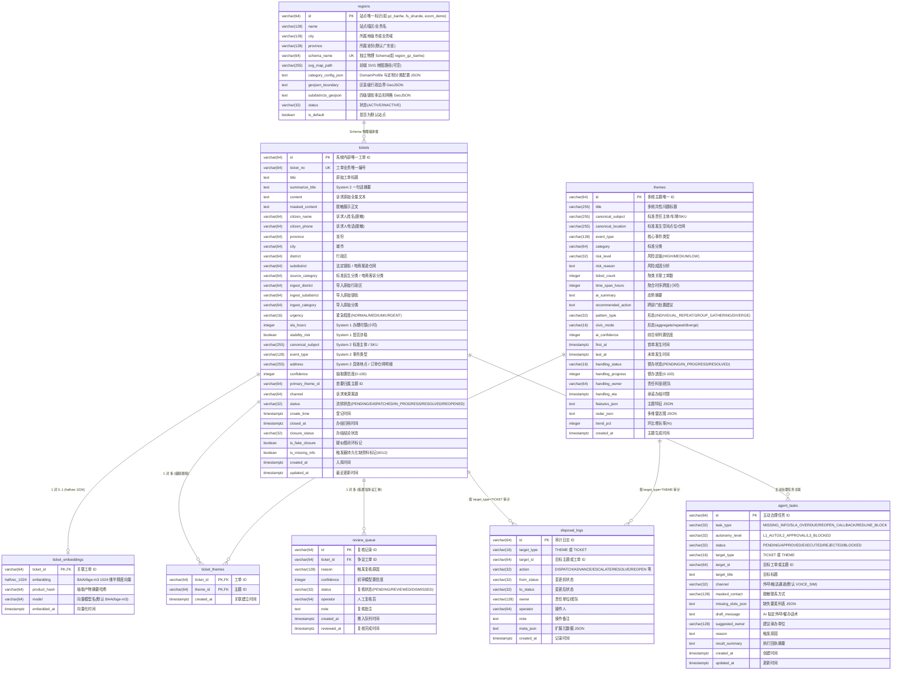

# 数据库表结构与字段字典 (Database Schema & Dictionary)

> **项目名称**：民声智理 · 12345 政务热线认知中枢与 AI 智能研判系统 (多城市 / 多租户 / 双业务域 V2 生产架构)  
> **研发团队**：赢了就回家吃鱼生  
> **ORM 框架**：Drizzle ORM (`drizzle-orm ^0.45.2` + `postgres.js ^3.4.9`)  
> **数据库引擎**：PostgreSQL 16 + `pgvector` (`pgvector/pgvector:pg16`) + `pg_trgm`（多租户独立 Schema 物理隔离 / `halfvec(1024)` 半精度向量 / 覆盖索引与部分索引）

---

## 目录
1. [数据表关系拓扑 (ER Diagram)](#一数据表关系拓扑-er-diagram)
2. [多城市独立 Schema 物理隔离与真实租户规模](#二多城市独立-schema-物理隔离与真实租户规模)
3. [核心数据表详细字典](#三核心数据表详细字典)
   - [0. 区域/站点注册花名册表 (`public.regions`)](#0-区域站点注册花名册表-regions---public-schema)
   - [1. 工单主表 (`tickets`) 与触发器列 `is_missing_info`](#1-工单主表-tickets-ticketstable)
   - [1b. 工单向量旁路表 (`ticket_embeddings`)](#1b-工单向量旁路表-ticket_embeddings-ticketembeddingstable)
   - [2. 多频主题聚类表 (`themes`)](#2-多频主题聚类表-themes-themestable)
   - [3. 工单-主题多对多关联表 (`ticket_themes`)](#3-工单-主题多对多关联表-ticket_themes-ticketthemestable)
   - [4. 人工复核队列 (`review_queue`)](#4-人工复核队列-review_queue-reviewqueuetable)
   - [5. 官方标准政务词汇表 (`vocabularies`)](#5-官方标准政务词汇表-vocabularies-vocabulariestable)
   - [6. 别名与实体对齐知识库 (`aliases`)](#6-别名与实体对齐知识库-aliases-aliasestable)
   - [7. 任务进度持久化表 (`task_progress`)](#7-任务进度持久化表-task_progress-taskprogresstable)
   - [8. 处置流转与人工纠偏审计日志表 (`disposal_logs`)](#8-处置流转与人工纠偏审计日志表-disposal_logs-disposallogstable)
   - [9. 主动治理待办与专报表 (`agent_tasks` / `agent_reports` / `public.citizen_submissions`)](#9-主动治理待办与专报表-agent_tasks--agent_reports--publiccitizen_submissions)
   - [10. 动态算力节点花名册表 (`public.compute_nodes`)](#10-动态算力节点花名册表-publiccompute_nodes-computenodestable)
   - [11. 用户与认证体系表 (Better Auth)](#11-用户与认证体系表-better-auth-security-schema)
   - [12. MCP 接入表 (`public.mcp_clients` / `public.mcp_auth_codes`)](#12-mcp-接入表-mcp_clients--mcp_auth_codes)
4. [性能索引与关键迁移清单 (`0011` / `0012`)](#四性能索引与关键迁移清单-0011--0012)
5. [PostgreSQL 16 生产调优与 `VACUUM ANALYZE` 运维](#五postgresql-16-生产调优与-vacuum-analyze-运维)
6. [数据库脚本与运维常用命令](#六数据库脚本与运维常用命令)

---

## 一、数据表关系拓扑 (ER Diagram)



---

## 二、多城市独立 Schema 物理隔离与真实租户规模

系统采用 **PostgreSQL 独立 Schema 物理隔离 + `APP_DOMAIN` 业务域隔离** 架构，同一套 PostgreSQL 16 实例承载政务热线与电商售后双业务域，杜绝跨租户、跨业务域数据串扰：

```text
PostgreSQL 16 实例 (ticket_radar, image: pgvector/pgvector:pg16)
├── public (全局元数据、认证、算力与接入空间)
│   ├── regions (区域/站点花名册，含 DomainProfile 与 GeoJSON 边界)
│   ├── compute_nodes (热插拔动态算力节点池：LOCAL / COLAB / CLOUD)
│   ├── citizen_submissions (市民自助上报追踪映射表)
│   ├── user / session / account / verification (Better Auth 全局认证表)
│   ├── mcp_clients / mcp_auth_codes (MCP 客户端与一次性授权码)
│   └── 函数: compute_ticket_is_missing_info() / trg_tickets_sync_missing_info()
├── region_gz_tianhe   (广州市天河区 · GOV_12345 · ~106.5k 工单)
├── region_fs_shunde   (佛山市顺德区 · GOV_12345 · ~138.7k 工单)
├── region_ecom_demo   (电商售后客诉示范站 · ECOMMERCE_CS · 3,240 工单)
└── region_{id}        (任意新城市 AI Scout 拓荒独立 Schema)
    └── 独立表集: tickets / ticket_embeddings / themes / ticket_themes /
                  review_queue / vocabularies / aliases / task_progress /
                  disposal_logs / agent_tasks / agent_reports
```

### 生产在网核心租户清单

| 站点 ID (`regions.id`) | 物理 Schema (`schema_name`) | 所属业务域 (`domainType`) | 地理地图 (`hasGeoMap`) | 真实工单规模 | 说明 |
| :--- | :--- | :--- | :---: | :---: | :--- |
| **`gz_tianhe`** | `region_gz_tianhe` | `GOV_12345` | `true`（21 街道矢量网格） | **~106.5k** | 广州市天河区政务热线示范站点（`GOV_12345` 默认落点） |
| **`fs_shunde`** | `region_fs_shunde` | `GOV_12345` | `true`（10 镇街矢量网格） | **~138.7k** | 佛山市顺德区政务热线示范站点 |
| **`ecom_demo`** | `region_ecom_demo` | `ECOMMERCE_CS` | `false`（全渠道仓网矩阵） | **3,240** | 电商售后客诉中心独立域（`ECOMMERCE_CS` 默认落点） |

- **动态路由与业务域隔离**：应用通过 `lib/app-domain.ts` 读取运行期环境变量 `APP_DOMAIN`（`GOV_12345` / `ECOMMERCE_CS` / `ALL`），配合 `lib/tenant/request-region.ts` 与 `getRegionDb(regionId)` 强制过滤租户范围，同一镜像在 `12345.firetable.tech` 仅暴露政务租户、在 `ecom.firetable.tech` 仅暴露电商租户。
- **新租户自动初始化**：`lib/tenant/schema-manager.ts` 的 `createTenantTables()` 在创建新 Schema 时自动启用 `vector` 与 `pg_trgm` 扩展、挂载域感知的 `trg_tickets_sync_missing_info` 触发器（根据 `category_config_json` 区分 `is_ecommerce`），并创建全部 `0011` 与 `0012` 性能索引。

---

## 三、核心数据表详细字典

### 0. 区域/站点注册花名册表：`regions` (`regionsTable` in `public` schema)
> 存储全局已注册的城市/区县或业务域站点信息、独立 Schema 映射名、`DomainProfile` 配置与 GIS 边界资源。

| 字段名 | 数据库类型 | 约束 / 索引 | 描述 | 数据来源 / 算法说明 |
| :--- | :--- | :--- | :--- | :--- |
| `id` | `VARCHAR(64)` | `PRIMARY KEY` | 站点唯一标识符 | 如 `gz_tianhe`、`fs_shunde`、`ecom_demo` |
| `name` | `VARCHAR(128)` | `NOT NULL` | 站点辖区或业务名 | 如 `天河区`、`顺德区`、`电商售后中心` |
| `city` | `VARCHAR(128)` | `NOT NULL, INDEX` | 所属地级市/业务线 | 如 `广州市`、`佛山市` |
| `province` | `VARCHAR(128)` | `NOT NULL, DEFAULT '广东省'` | 所属省份 | 默认 `广东省` |
| `schema_name` | `VARCHAR(64)` | `NOT NULL, UNIQUE, INDEX` | 对应的独立物理 Schema | 如 `region_gz_tianhe`、`region_fs_shunde`、`region_ecom_demo` |
| `svg_map_path` | `VARCHAR(255)` | `NULLABLE` | 备用 SVG 地图资源路径 | 历史兼容字段，现行 GIS 主走 GeoJSON + 天地图 |
| `category_config_json` | `TEXT` | `NULLABLE` | `DomainProfile` 与分类配置 JSON | 含 `domainType`、`hasGeoMap`、`categories`、`channels`、`terminology`、`promptPersona` |
| `geojson_boundary` | `TEXT` | `NULLABLE` | 三级行政区边界 GeoJSON | 由 `lib/map/boundary-service.ts` 拉取或上传 |
| `subdistricts_geojson` | `TEXT` | `NULLABLE` | 四级镇街矢量网格 GeoJSON | 优先于 `/public/civic/<id>-townships.geojson` 静态兜底 |
| `status` | `VARCHAR(32)` | `NOT NULL, INDEX, DEFAULT 'ACTIVE'` | 站点状态 | `ACTIVE` 启用 / `INACTIVE` 停用 |
| `is_default` | `BOOLEAN` | `NOT NULL, DEFAULT FALSE` | 是否为默认站点 | 配合 `APP_DOMAIN` 决定首屏默认加载租户 |
| `description` | `TEXT` | `NULLABLE` | 站点说明备注 | 站点特性、数据量及管理主体备忘 |
| `created_at` / `updated_at` | `TIMESTAMPTZ` | `NOT NULL, DEFAULT NOW` | 创建 / 更新时间 | 站点元数据时间戳 |

---

### 1. 工单主表：`tickets` (`ticketsTable`)
> 存储工单全生命周期基础记录，承载原始诉求、AI 结构化抽取字段、脱敏正文、假闭环标记及触发器持久化缺资料标记。

| 字段名 | 数据库类型 | 约束 / 索引 | 描述 | 数据来源 / 算法说明 |
| :--- | :--- | :--- | :--- | :--- |
| `id` | `VARCHAR(64)` | `PRIMARY KEY` | 工单唯一系统主键 ID | 系统按 `tk-{timestamp}-{index}` 等规则分配 |
| `ticket_no` | `VARCHAR(64)` | `NOT NULL, UNIQUE, INDEX, TRGM` | 业务工单编号 | 政务编号如 `250101000770102-01`（前 6 位年月日 + 受理序号 + 事项代码 + 重办序号） |
| `title` | `TEXT` | `NULLABLE, TRGM` | 原始工单标题 | 可空，市民原文在 `content` |
| `summarize_title` | `TEXT` | `NULLABLE, TRGM` | 一句话摘要 | System 2 抽取生成 |
| `content` | `TEXT` | `NOT NULL, TRGM` | 诉求原始全文 | 核心数据源 |
| `masked_content` | `TEXT` | `NULLABLE` | 隐私脱敏展示文本 | 经 `@civic/anonymizer` 对人名、电话、证件号等 PII 掩码 |
| `citizen_name` / `citizen_phone` | `VARCHAR(64)` | `NULLABLE` | 诉求人姓名 / 联系电话 | 脱敏掩码存储（如 `张*`、`138****1234`） |
| `province` / `city` / `district` | `VARCHAR(64)` | `NULLABLE` (`district` 含 `TRGM`) | 省 / 市 / 行政区 | 所属行政区划 |
| `subdistrict` | `VARCHAR(64)` | `INDEX, TRGM, NULLABLE` | 法定镇街 / 电商渠道仓网 | 政务域对齐法定镇街词典；电商域对应渠道/仓网名 |
| `source_category` | `VARCHAR(64)` | `INDEX, TRGM, NULLABLE` | 标准分类 | 政务 7 大民生分类 / 电商 7 大客诉分类 |
| `ingest_district` / `ingest_subdistrict` / `ingest_category` | `VARCHAR(64)` | `NULLABLE` | 导入原始区划与分类 | 文件原始列（未经 AI 改写） |
| `urgency` | `VARCHAR(16)` | `INDEX, DEFAULT 'NORMAL'` | 紧急程度 | `NORMAL` / `MEDIUM` / `URGENT`（涉稳或 3 级置为 `URGENT`） |
| `sla_hours` | `INTEGER` | `NULLABLE` | 办理时限（小时） | System 1 输出：0、120、24、2 小时 |
| `stability_risk` | `BOOLEAN` | `NULLABLE, PARTIAL INDEX` | 是否涉稳 | System 1 涉稳头 + 符号红线互锁判定 |
| `canonical_subject` | `VARCHAR(255)` | `NULLABLE, TRGM` | 标准主体 / 涉事 SKU | System 2 抽取，最长 255 字 |
| `event_type` | `VARCHAR(128)` | `NULLABLE` | 核心事件类型 | System 2 抽取，最长 128 字 |
| `address` | `VARCHAR(255)` | `NULLABLE, TRGM` | 具体地点 / 订单仓网明细 | System 2 抽取的事发地点 |
| `confidence` | `INTEGER` | `NULLABLE` | 抽取置信度 (0~100) | 低于 60 进入人工复核队列；主体抽空时上限压至 55 |
| `primary_theme_id` | `VARCHAR(64)` | `INDEX, NULLABLE` | 首要归属主题 ID | 聚类关联的多频群组 ID |
| `channel` | `VARCHAR(64)` | `DEFAULT '市民服务热线'` | 诉求来源渠道 | 市民服务热线 / 政务微信 / MCP / 电商平台等 |
| `status` | `VARCHAR(32)` | `INDEX, DEFAULT 'PENDING'` | 工单流转状态 | 4 态统一：`PENDING`（待派单）/ `DISPATCHED`（已派单）/ `IN_PROGRESS`（处理中）/ `RESOLVED`（已办结），另含 `REOPENED`（假闭环重开，在 `tab=pending` 优先置顶） |
| `create_time` | `TIMESTAMPTZ` | `INDEX, NULLABLE` | 登记时间 | 编号前 6 位对应的上海时区当天 00:00；无法解析时取正文时间 |
| `closed_at` | `TIMESTAMPTZ` | `INDEX, NULLABLE` | 办结归档时间 | 结案时间戳 |
| `closure_status` | `VARCHAR(32)` | `NULLABLE` | 办结结论状态 | 如 `已办结` / `处理中` / `退单` |
| `is_fake_closure` | `BOOLEAN` | `DEFAULT FALSE, PARTIAL INDEX` | 疑似假闭环标记 | 办结后 7 天内复发、48h 回访核验未解决或市民主动重开时置为 `true` |
| `is_missing_info` | `BOOLEAN` | `NOT NULL, DEFAULT FALSE, PARTIAL INDEX` | **缺资料预计算标记 (`0012`)** | 由 `BEFORE INSERT OR UPDATE` 触发器 `trg_tickets_sync_missing_info` 自动维护，与 `lib/civic-missing.ts` 规则 100% 等价 |
| `created_at` / `updated_at` | `TIMESTAMPTZ` | `DEFAULT NOW` | 入库时间 / 最近更新时间 | `updated_at` 用于 `REOPENED` 与假闭环待派单置顶排序 |

> **说明**：`is_missing_info` 由 `0012_perf_indexes.sql` 迁移及 `lib/tenant/schema-manager.ts` 维护（未直接声明在早期 Drizzle 生成快照中）；应用侧通过 `lib/civic-missing.ts` 的 `buildMissingInfoFlagSql()` 命中部分索引 `idx_tickets_missing_info_ct`，若遇未执行 `0012` 的旧库（PostgreSQL `42703` 错误）会自动通过 `isUndefinedColumnError()` 降级到实时表达式。

---

### 1b. 工单向量旁路表：`ticket_embeddings` (`ticketEmbeddingsTable`)
> 独立旁路存储 `BAAI/bge-m3` 1024 维半精度向量，不在 `tickets` 主表上挂载大向量列，避免污染主表宽行与堆表 I/O。

| 字段名 | 数据库类型 | 约束 / 索引 | 描述 |
| :--- | :--- | :--- | :--- |
| `ticket_id` | `VARCHAR(64)` | `PRIMARY KEY, FK -> tickets.id (CASCADE)` | 一行对应一张工单，缺行即未向量化 |
| `embedding` | `HALFVEC(1024)` | `NOT NULL` | `pgvector` 半精度 1024 维向量（HNSW 索引在回填完成后按需单独构建） |
| `product_hash` | `VARCHAR(64)` | `NOT NULL` | 抽取产物文本哈希，用于增量判断向量是否过期 |
| `model` | `VARCHAR(64)` | `NOT NULL, DEFAULT 'BAAI/bge-m3'` | 嵌入模型标识 |
| `embedded_at` | `TIMESTAMPTZ` | `NOT NULL, DEFAULT NOW` | 向量写入时间 |

---

### 2. 多频主题聚类表：`themes` (`themesTable`)
> 两条及以上、被判定为同一件事或同一个具体地点的工单收成一个主题；单发件不进此表。

| 字段名 | 数据库类型 | 约束 / 索引 | 描述 | 数据来源 / 算法说明 |
| :--- | :--- | :--- | :--- | :--- |
| `id` | `VARCHAR(64)` | `PRIMARY KEY` | 多频主题唯一 ID | 如 `thm-{timestamp}-{index}` |
| `title` | `VARCHAR(255)` | `NOT NULL, TRGM` | 多频共性问题标题 | 优先取一致具体主体或共同小区/地标 |
| `canonical_subject` | `VARCHAR(255)` | `NOT NULL, INDEX, TRGM` | 标准责任主体 / SKU | 精确对齐的主体或字号 |
| `canonical_location` | `VARCHAR(255)` | `NOT NULL, TRGM` | 标准空间位置 / 仓网 | 微观核心地点或渠道仓网 |
| `event_type` | `VARCHAR(128)` | `NOT NULL, TRGM` | 核心事件类型 | 抽象标准业务事件 |
| `category` | `VARCHAR(64)` | `DEFAULT '城市管理', TRGM` | 标准分类 | 7 大民生分类 / 7 大电商客诉分类 |
| `risk_level` | `VARCHAR(32)` | `NOT NULL, INDEX, DEFAULT 'LOW'` | 风险研判等级 | `HIGH` / `MEDIUM` / `LOW`（规则定档，LLM 不可降级） |
| `risk_reason` | `TEXT` | `NULLABLE` | 风险归因分析 | 诉求集中度、涉稳与假闭环归因 |
| `ticket_count` | `INTEGER` | `NOT NULL, INDEX, DEFAULT 0` | 聚类关联工单数 | 群组内成员件数 |
| `time_span_hours` | `INTEGER` | `NOT NULL, DEFAULT 1` | 聚合时间跨度（小时） | 首末单时间差 |
| `ai_summary` | `TEXT` | `NULLABLE` | 态势全貌摘要 | System 2 概括 |
| `recommended_action` | `TEXT` | `NULLABLE` | 跨部门处置建议 | 仅面向 ≥2 件多频主题生成；空缺由 `advice-backfill.ts` 补齐 |
| `pattern_type` | `VARCHAR(32)` | `INDEX, NULLABLE` | 聚类形态 | `INDIVIDUAL_REPEAT` / `GROUP_GATHERING` / `DIVERGE` |
| `civic_mode` | `VARCHAR(16)` | `NULLABLE` | 前端视图形态 | `aggregate` / `repeat` / `diverge` |
| `ai_confidence` | `INTEGER` | `NULLABLE` | 综合研判置信度 | 0~100 |
| `first_at` / `last_at` | `TIMESTAMPTZ` | `NULLABLE` | 首单 / 末单时间 | 群组内最早与最新工单时间 |
| `handling_status` | `VARCHAR(16)` | `DEFAULT 'PENDING'` | 督办状态 | 归一化为 `PENDING` / `IN_PROGRESS` / `RESOLVED`（兼容历史中文值） |
| `handling_progress` | `INTEGER` | `DEFAULT 0` | 督办处置进度 | 0 ~ 100 |
| `handling_owner` | `VARCHAR(64)` | `NULLABLE` | 牵头部门 / 责任团队 | 派单承办单位 |
| `handling_eta` | `TIMESTAMPTZ` | `NULLABLE` | 承诺办结时限 | 督办截止时间 |
| `features_json` / `radar_json` | `TEXT` | `NULLABLE` | 主题特征 / 雷达图评分 JSON | 确定性指标计算 |
| `trend_pct` | `INTEGER` | `NULLABLE` | 环比增长率 (%) | 趋势激化百分比 |
| `created_at` | `TIMESTAMPTZ` | `NOT NULL, INDEX (0012), DEFAULT NOW` | 主题生成时间 | `idx_themes_created_at` 加速趋势与增量查询 |

---

### 3. 工单-主题多对多关联表：`ticket_themes` (`ticketThemesTable`)

| 字段名 | 数据库类型 | 约束 / 索引 | 描述 |
| :--- | :--- | :--- | :--- |
| `ticket_id` | `VARCHAR(64)` | `PRIMARY KEY (复合), FK -> tickets.id (CASCADE), INDEX` | 底层工单 ID |
| `theme_id` | `VARCHAR(64)` | `PRIMARY KEY (复合), FK -> themes.id (CASCADE), INDEX` | 多频主题 ID |
| `created_at` | `TIMESTAMPTZ` | `NOT NULL, DEFAULT NOW` | 关联建立时间 |

---

### 4. 人工复核队列：`review_queue` (`reviewQueueTable`)
> 抽取置信度低于 60 或抽取异常的工单入队，由人工在 `/tickets` 的「待人工复核」Tab 分页裁定。

| 字段名 | 数据库类型 | 约束 / 索引 | 描述 |
| :--- | :--- | :--- | :--- |
| `id` | `VARCHAR(64)` | `PRIMARY KEY` | 复核记录主键 ID |
| `ticket_id` | `VARCHAR(64)` | `NOT NULL, FK -> tickets.id (CASCADE), INDEX` | 争议工单 ID |
| `reason` | `VARCHAR(128)` | `NOT NULL, DEFAULT 'LOW_CONFIDENCE'` | 触发原因（低置信度、通用主体等） |
| `confidence` | `INTEGER` | `NULLABLE` | 初审模型置信度 |
| `status` | `VARCHAR(32)` | `NOT NULL, INDEX, DEFAULT 'PENDING'` | `PENDING` / `REVIEWED` / `DISMISSED` |
| `operator` | `VARCHAR(64)` | `NULLABLE` | 复核人 |
| `note` | `TEXT` | `NULLABLE` | 复核批注 |
| `created_at` | `TIMESTAMPTZ` | `NOT NULL, INDEX (0011), DEFAULT NOW` | 推入队列时间（配合 `(status, created_at DESC, id DESC)` 稳定分页） |
| `reviewed_at` | `TIMESTAMPTZ` | `NULLABLE` | 复核完成时间 |

---

### 5. 官方标准政务词汇表：`vocabularies` (`vocabulariesTable`)
> 固化辖区法定镇街、村居社区、分类、部门及地理编码缓存（`type = 'LOCATION'`）。

| 字段名 | 数据库类型 | 约束 / 索引 | 描述 |
| :--- | :--- | :--- | :--- |
| `id` | `VARCHAR(64)` | `PRIMARY KEY` | 词汇唯一 ID（地理编码缓存采用 `LOC-<sha256>`） |
| `type` | `VARCHAR(32)` | `NOT NULL, INDEX` | `TOWNSHIP` / `COMMUNITY` / `CATEGORY` / `DEPARTMENT` / `LOCATION` |
| `name` | `VARCHAR(128)` | `NOT NULL, INDEX` | 标准名称或规范化地址 |
| `full_name` | `VARCHAR(255)` | `NULLABLE` | 官方全称 |
| `parent_name` | `VARCHAR(128)` | `NULLABLE` | 上级归属辖区 |
| `meta_json` | `TEXT` | `NULLABLE` | 扩展元数据 JSON（如经纬度坐标、边界信息等） |
| `description` | `TEXT` | `NULLABLE` | 词汇释义 |
| `is_standard` | `BOOLEAN` | `NOT NULL, DEFAULT TRUE` | 是否法定白名单强约束 |
| `created_at` | `TIMESTAMPTZ` | `NOT NULL, DEFAULT NOW` | 录入时间 |

---

### 6. 别名与实体对齐知识库：`aliases` (`aliasesTable`)

| 字段名 | 数据库类型 | 约束 / 索引 | 描述 |
| :--- | :--- | :--- | :--- |
| `id` | `VARCHAR(64)` | `PRIMARY KEY` | 别名映射 ID |
| `alias` | `VARCHAR(128)` | `NOT NULL, UNIQUE, INDEX` | 口语俗称/简称（如 `容奇`、`桂洲`） |
| `canonical` | `VARCHAR(128)` | `NOT NULL, INDEX` | 归一化法定标准名（如 `容桂街道`） |
| `type` | `VARCHAR(32)` | `NOT NULL, INDEX, DEFAULT 'ENTITY'` | `TOWNSHIP` / `LOCATION` / `SUBJECT` / `DEPARTMENT` / `ENTITY` |
| `source` | `VARCHAR(32)` | `NOT NULL, DEFAULT 'PRESET'` | `PRESET` / `AI_MINED` / `MANUAL` |
| `usage_count` | `INTEGER` | `NOT NULL, DEFAULT 0` | 匹配命中计数 |
| `created_at` | `TIMESTAMPTZ` | `NOT NULL, DEFAULT NOW` | 创建时间 |

---

### 7. 任务进度持久化表：`task_progress` (`taskProgressTable`)
> 记录按 region 隔离的异步研判任务状态、加权进度百分比与心跳时间。

| 字段名 | 数据库类型 | 约束 / 索引 | 描述 |
| :--- | :--- | :--- | :--- |
| `task_id` | `VARCHAR(128)` | `PRIMARY KEY` | 异步任务 ID（如 `auto-<regionId>-<timestamp>`） |
| `region_id` | `VARCHAR(64)` | `NULLABLE` | 绑定的租户站点 ID（per-region 隔离） |
| `status` | `VARCHAR(32)` | `NOT NULL, INDEX, DEFAULT 'PENDING'` | `PENDING` / `RUNNING` / `COMPLETED` / `FAILED` |
| `stage` | `VARCHAR(32)` | `NOT NULL, DEFAULT 'EXTRACTING'` | `PARSING` / `EXTRACTING` / `CLUSTERING` / `SYNTHESIZING` / `COMPLETED` |
| `stage_text` | `TEXT` | `NOT NULL, DEFAULT '准备就绪'` | 中文阶段描述 |
| `percent` | `INTEGER` | `NOT NULL, DEFAULT 0` | 加权百分比进度（0~100） |
| `total` / `processed` | `INTEGER` | `NOT NULL, DEFAULT 0` | 总工单数 / 已处理单数 |
| `extracted_count` / `theme_count` / `review_count` / `failed_count` | `INTEGER` | `NOT NULL, DEFAULT 0` | 抽取数 / 主题数 / 复核数 / 失败数 |
| `error` | `TEXT` | `NULLABLE` | 异常报错信息 |
| `heartbeat_at` | `TIMESTAMPTZ` | `NULLABLE` | Worker 心跳时间（用于僵尸任务回收） |
| `created_at` / `updated_at` | `TIMESTAMPTZ` | `NOT NULL, INDEX, DEFAULT NOW` | 启动与更新时间 |

---

### 8. 处置流转与人工纠偏审计日志表：`disposal_logs` (`disposalLogsTable`)
> 全量记录工单与主题的派单、推进、升级、办结、重开、复核与要素补全操作轨迹，支撑管理员处置时间线与市民端进度追踪。

| 字段名 | 数据库类型 | 约束 / 索引 | 描述 |
| :--- | :--- | :--- | :--- |
| `id` | `VARCHAR(64)` | `PRIMARY KEY` | 日志唯一 ID |
| `target_type` | `VARCHAR(16)` | `NOT NULL, COMPOSITE INDEX` | `THEME` 或 `TICKET` |
| `target_id` | `VARCHAR(64)` | `NOT NULL, COMPOSITE INDEX` | 目标主题或工单 ID |
| `action` | `VARCHAR(32)` | `NOT NULL` | `DISPATCH` / `ADVANCE` / `ESCALATE` / `RESOLVE` / `REOPEN` / `CORRECT_ENTITY` / `DETACH_TICKET` / `REVIEW_APPROVE` / `REVIEW_DISMISS` 等 |
| `from_status` / `to_status` | `VARCHAR(32)` | `NULLABLE` | 状态流转前后值 |
| `owner` | `VARCHAR(128)` | `NULLABLE` | 承办科室 / 责任团队 |
| `operator` | `VARCHAR(64)` | `NULLABLE` | 操作人（管理员、市民或 `agent-governance`） |
| `note` | `TEXT` | `NULLABLE` | 处置批注 / 重开原因 / 外呼回执 |
| `meta_json` | `TEXT` | `NULLABLE` | 扩展审计上下文 JSON |
| `created_at` | `TIMESTAMPTZ` | `NOT NULL, INDEX, DEFAULT NOW` | 记录时间 |

---

### 9. 主动治理待办与专报表 (`agent_tasks` / `agent_reports` / `public.citizen_submissions`)
> 由 `lib/agent-governance.ts` 幂等建表（`ensureAgentGovernanceTables` 与 `ensureCitizenSubmissionsTable`），支撑 `/agent` 主动治理与 `/submit` 市民端闭环。

1. **`<schema>.agent_tasks`**：主动治理待办队列
   - 字段：`id (PK)`、`task_type`（`MISSING_INFO` / `SLA_OVERDUE` / `REOPEN_CALLBACK` / `REDLINE_BLOCK`）、`autonomy_level`（`L1_AUTO` / `L2_APPROVAL` / `L3_BLOCKED`）、`status`（`PENDING` / `APPROVED` / `EXECUTED` / `REJECTED` / `BLOCKED`）、`target_type`（`TICKET` / `THEME`）、`target_id`、`target_title`、`channel`（默认 `VOICE_SIM`）、`masked_contact`、`missing_slots_json`、`draft_message`、`suggested_owner`、`reason`、`result_summary`、`created_at`、`updated_at`。
   - 索引：`idx_agent_tasks_status (status, autonomy_level)`、`idx_agent_tasks_target (target_type, target_id, task_type)`。
2. **`<schema>.agent_reports`**：每日/周期治理专报存档
   - 字段：`id (PK)`、`report_date (VARCHAR(16))`、`title`、`markdown`、`stats_json`、`created_at`。
   - 索引：`idx_agent_reports_date (report_date, created_at DESC)`。
3. **`public.citizen_submissions`**：市民自助上报归属映射表
   - 字段：`id (PK)`、`user_id`（Better Auth 用户 ID）、`region_id`、`ticket_id`、`ticket_no`、`title`、`category`、`subdistrict`、`created_at`。
   - 索引：`idx_citizen_submissions_user_region (user_id, region_id)`、`idx_citizen_submissions_ticket (ticket_id)`。

---

### 10. 动态算力节点花名册表：`public.compute_nodes` (`computeNodesTable`)
> 支持在运行期通过 `/admin/regions` 热插拔挂载本地、Google Colab 或云端推理与向量节点，无需重启容器。

| 字段名 | 数据库类型 | 约束 / 索引 | 描述 |
| :--- | :--- | :--- | :--- |
| `id` | `VARCHAR(64)` | `PRIMARY KEY` | 节点唯一 ID |
| `name` | `VARCHAR(128)` | `NOT NULL` | 节点展示名称 |
| `role` | `VARCHAR(32)` | `NOT NULL, INDEX, DEFAULT 'SYSTEM_TWO'` | `SYSTEM_TWO` 或 `EMBEDDING` |
| `provider` | `VARCHAR(32)` | `NOT NULL, DEFAULT 'COLAB'` | `LOCAL` / `COLAB` / `CLOUD` |
| `endpoint` | `VARCHAR(512)` | `NOT NULL` | OpenAI 兼容端点 URL |
| `api_key` | `VARCHAR(255)` | `NULLABLE` | 可选节点鉴权 Key（界面脱敏展示） |
| `model` | `VARCHAR(128)` | `NULLABLE` | 指定模型名 |
| `enabled` | `BOOLEAN` | `NOT NULL, INDEX, DEFAULT TRUE` | 是否参与调度池 |
| `last_status` / `last_latency_ms` / `last_checked_at` | `VARCHAR(32)` / `INTEGER` / `TIMESTAMPTZ` | `NULLABLE` | 最近探活状态（`ONLINE`/`OFFLINE`）、耗时与时间 |

---

### 11. 用户与认证体系表 (Better Auth Security Schema)
> 位于 `public` Schema（定义见 `lib/auth/schema.ts`），由 Better Auth + Drizzle Adapter 管理，并在 `lib/auth/config.ts` 开启 `session.cookieCache`（`maxAge: 300s` HMAC 签名缓存）降低高频 API 对 `session`/`user` 表的重复回查。

- **`user`**：`id (PK)`、`name`、`email (UNIQUE)`、`email_verified`、`image`、`role`（`admin` / `user` / `operator`）、`username (UNIQUE)`、`created_at`、`updated_at`。
- **`session`**：`id (PK)`、`expires_at`、`token (UNIQUE)`、`ip_address`、`user_agent`、`user_id (FK -> user.id CASCADE)`、`created_at`、`updated_at`。
- **`account`**：`id (PK)`、`account_id`、`provider_id`、`user_id (FK -> user.id CASCADE)`、`password`、`created_at`、`updated_at` 等凭据列。
- **`verification`**：Better Auth 标准校验令牌表。

---

### 12. MCP 接入表 (`mcp_clients` / `mcp_auth_codes`)
> 位于 `public` Schema，由 `lib/mcp/clients.ts` 的 `ensureMcpTables()` 在首次签发、校验或吊销时幂等创建。对接流程见 [`MCP.md`](MCP.md)。

- **`mcp_clients`**：`id (PK, mcp_*)`、`name`、`user_id (FK -> user.id CASCADE)`、`token_hash (UNIQUE, SHA-256 hex)`、`created_at`、`revoked_at`、`last_used_at`；索引：`idx_mcp_clients_user`、`idx_mcp_clients_token_hash`。
- **`mcp_auth_codes`**：`code_hash (PK, SHA-256 hex)`、`client_name`、`user_id`、`redirect_uri`、`code_challenge (PKCE S256)`、`expires_at (10 min)`、`used_at`。

---

## 四、性能索引与关键迁移清单 (`0011` / `0012`)

面向 10 万+ 级单租户大表（天河 ~106.5k、顺德 ~138.7k），`db/migrations/` 已沉淀两份核心幂等性能优化迁移，均自动遍历 `public` 与所有 `region_%` 租户 Schema：

### 1. `0011_trgm_and_review_indexes.sql`（模糊检索与复核分页加速）
- 启用扩展：`CREATE EXTENSION IF NOT EXISTS pg_trgm;`
- **`tickets` 9 列 `gin_trgm_ops` GIN 索引**：`title`、`summarize_title`、`content`、`canonical_subject`、`address`、`ticket_no`、`subdistrict`、`district`、`source_category`，大幅加速工单中心关键词 `ILIKE` 检索与 Copilot 混合召回。
- **`themes` 5 列 `gin_trgm_ops` GIN 索引**：`title`、`canonical_subject`、`canonical_location`、`event_type`、`category`。
- **`tickets` 排序与高危部分索引**：
  - `idx_tickets_subdistrict_create_time (subdistrict, create_time DESC)`
  - `idx_tickets_create_time_id_desc (create_time DESC, id DESC)`
  - `idx_tickets_primary_theme_create_time (primary_theme_id, create_time DESC)`
  - `idx_tickets_fake_closure_true (create_time DESC) WHERE is_fake_closure = true`
  - `idx_tickets_stability_risk_true (create_time DESC) WHERE stability_risk = true`
- **`review_queue` 稳定分页索引**：
  - `idx_review_queue_status_created_at (status, created_at DESC, id DESC)`
  - `idx_review_queue_created_at_desc (created_at DESC, id DESC)`

### 2. `0012_perf_indexes.sql`（缺资料持久化触发器 + 三段归并 + 覆盖索引）
1. **`is_missing_info` 触发器持久化列与部分索引（彻底消除全表 POSIX 正则扫描）**：
   - 创建 `public.compute_ticket_is_missing_info(p_status, p_address, p_subdistrict, p_canonical_subject, p_is_ecommerce)`（`IMMUTABLE PARALLEL SAFE`），规则与 `lib/civic-missing.ts` 完全一致：已办结工单返回 `false`；镇街/渠道为空、地址为空或等于镇街（电商域地址长度 ≤ 6）、主体为空或命中 50+ 通用泛化词/正则时返回 `true`。
   - 为各租户 `tickets` 表幂等添加 `updated_at` 与 `is_missing_info BOOLEAN NOT NULL DEFAULT false`，增量回填存量变化行，并挂载固化了域参数（`'true'` / `'false'`）的 `BEFORE INSERT OR UPDATE OF status, address, subdistrict, canonical_subject, is_missing_info` 触发器 `trg_tickets_sync_missing_info`。
   - 建立部分索引：`idx_tickets_missing_info_ct ON tickets (create_time DESC, id DESC) WHERE is_missing_info = true`，让 `GET /api/workorders?tab=missing_info` 与统计聚合毫秒级命中。
2. **`tab=pending` 三段归并索引（消除 10 万+ 行全表 `CASE` 排序）**：
   - `idx_tickets_reopened_updated_at ON tickets (updated_at DESC NULLS LAST, create_time DESC, id DESC) WHERE status = 'REOPENED'`
   - `idx_tickets_fake_closure_pending ON tickets (updated_at DESC NULLS LAST, create_time DESC, id DESC) WHERE is_fake_closure IS TRUE AND status IN ('PENDING', 'REOPENED')`
   - `idx_tickets_status_create_time_id_desc ON tickets (status, create_time DESC, id DESC) INCLUDE (is_fake_closure)`
   - 配合 `app/api/workorders/route.ts` 的 `fetchPendingOrderedPage()` 按 `REOPENED` → `PENDING & is_fake_closure` → 普通 `PENDING` 三段独立走索引归并分页。
3. **覆盖索引（开启纯 Index-Only Scan，大幅降低堆表随机 I/O）**：
   - `idx_tickets_id_subd_status ON tickets (id) INCLUDE (subdistrict, status)`：加速 `loadClusterBundle` 中 `ticket_themes INNER JOIN tickets` 关联投影。
   - `idx_tickets_stats_cover ON tickets (create_time) INCLUDE (subdistrict, source_category, status, urgency, confidence, primary_theme_id, closed_at, is_fake_closure, is_missing_info)`：统一覆盖 `loadOverview` / `loadWorkorderStats` / `loadTrends` 全部统计列。
   - `idx_themes_created_at ON themes (created_at)`：加速主题时间窗口查询。

---

## 五、PostgreSQL 16 生产调优与 `VACUUM ANALYZE` 运维

### 1. 容器级内核参数（与 `docker-compose.yml` 保持同步）
面向 8 GB 内存 VPS 承载 24.8 万+ 总工单（多租户并发查询 + `pgvector` + 覆盖索引），`12345-postgres`（`pgvector/pgvector:pg16`）生产启动参数配置如下：

| 参数 | 生产配置值 | 调优作用 |
| :--- | :--- | :--- |
| **`shm_size`** | `512m` | 扩大 `/dev/shm` 共享内存，防止并行查询（Parallel Query）与大聚合触发共享内存耗尽 |
| **`shared_buffers`** | `1GB` | 将高频覆盖索引与热页常驻 PostgreSQL 共享缓冲池 |
| **`effective_cache_size`** | `4GB` | 引导查询规划器充分计入 OS Page Cache，优先选择 Index-Only Scan |
| **`work_mem`** | `32MB` | 提升排序、Hash Aggregate 与多维分组的内存预算，减少落盘临时文件 |
| **`maintenance_work_mem`** | `256MB` | 加速 `CREATE INDEX`、`VACUUM ANALYZE` 与迁移回填 |
| **`random_page_cost`** | `1.1` | 贴合 NVMe SSD 随机读特性，避免规划器低估索引扫描并误退化为全表 Seq Scan |
| **`jit`** | `off` | 关闭 LLVM JIT 编译开销，消除短耗时 OLTP / 仪表盘聚合 SQL 的编译抖动 |
| **`max_parallel_workers_per_gather`** | `2` | 合理控制单查询并行度，防止并发请求打满 VPS CPU |
| **`checkpoint_completion_target`** | `0.9` | 平滑刷脏页 I/O，降低批量写入或回填时的尾延迟尖刺 |

### 2. `VACUUM ANALYZE` 与 Visibility Map 运维说明
执行 `0012_perf_indexes.sql`（或大批量导入/回填）后，覆盖索引（`idx_tickets_stats_cover`、`idx_tickets_id_subd_status`）要发挥 **纯 Index-Only Scan（`Heap Fetches: 0`）** 效果，依赖 PostgreSQL 的 **Visibility Map（可见性映射）** 已标亮全可见页。`ANALYZE` 仅更新统计信息，不会刷亮 Visibility Map，因此**存量大表首次迁移或大批量导入后必须执行 `VACUUM ANALYZE`**：

```bash
# 在 VPS 上对全部核心租户表执行 VACUUM ANALYZE，刷亮 Visibility Map 并刷新统计信息
docker exec 12345-postgres psql -U postgres -d ticket_radar -c "
  VACUUM ANALYZE region_gz_tianhe.tickets;
  VACUUM ANALYZE region_gz_tianhe.themes;
  VACUUM ANALYZE region_fs_shunde.tickets;
  VACUUM ANALYZE region_fs_shunde.themes;
  VACUUM ANALYZE region_ecom_demo.tickets;
  VACUUM ANALYZE region_ecom_demo.themes;
"
```

---

## 六、数据库脚本与运维常用命令

| 业务目标 | 对应 NPM 命令 | 底层脚本路径 | 说明 |
| :--- | :--- | :--- | :--- |
| **全量一键初始化** | `pnpm db:init` | `scripts/db-init.ts` | 一键执行表迁移、站点注册、行政边界、数据字典、管理员账号 |
| **管理员账号初始化** | `pnpm db:init-admin` / `pnpm db:seed-admin` | `scripts/init-admin.ts` | 初始化/重置默认管理员账号与市民体验账号 |
| **多租户站点拓荒** | `pnpm db:init-tenants` | `scripts/init-tenants.ts` | 初始化/重置租户 Schema、高精边界及标准字典 |
| **数据库迁移** | `pnpm db:migrate` | `scripts/db-migrate.ts` | 幂等执行 `db/migrations/` 下的 SQL 迁移脚本（含 `0011` / `0012`） |
| **词库同步** | `pnpm db:vocab` | `scripts/seed-vocabulary.ts` | 导入辖区法定镇街、村居及预置别名知识库 |
| **数据备份导出** | `pnpm db:export` | `scripts/db-export.ts` | 导出全库数据为 `db/dumps/ticket_radar_data.json` |
| **数据离线恢复** | `pnpm db:import` | `scripts/db-import.ts` | 从 json dump 快速全量恢复库数据 |
| **主备库同步** | `pnpm db:push-vps` / `pnpm db:pull-vps` | `scripts/sync-db.sh` | 本地与 VPS 数据库双向同步 |
| **清空业务表** | `pnpm db:clear` | `scripts/db-clear.ts` | 安全清空工单与主题数据（保留多租户站点与字典配置） |
| **Drizzle Studio** | `pnpm db:studio` | `drizzle-kit studio` | 启动本地可视化数据库管理控制台 (Port 4983) |
