# 民声智理 · 全站页面功能与界面说明 (Page Architecture & UI Guide)

> 本文档按路由与全局组件逐一拆解系统全站 **15 个页面路由（14 个功能页 + `/admin` 跳转入口）** 与 **2 个全局交互抽屉** 的访问权限、核心模块、交互逻辑、关联 API、双域差异与实机截图（均于生产环境 `ticket-radar:v0.1.7` 下采集）。
>
> - **政务 12345 主站**：https://12345.firetable.tech （`APP_DOMAIN=GOV_12345`，广州市·天河区 106k+ / 佛山市·顺德区 138k+）
> - **跨行业电商客诉站**：https://ecom.firetable.tech （`APP_DOMAIN=ECOMMERCE_CS`，电商售后客诉中心 3,240 条 / 40 专题）

---

## 目录

- [一、全站路由与全局抽屉总览](#一全站路由与全局抽屉总览)
- [二、逐页功能与界面详解](#二逐页功能与界面详解)
  - [1. 数据总览 `/` & 全局研判抽屉](#1-数据总览--与全局研判抽屉)
  - [2. 市民/买家智能受理门户 `/submit`](#2-市民买家智能受理门户-submit)
  - [3. 工单中心 `/tickets` 与工单详情 `/tickets/[id]`](#3-工单中心-tickets-与工单详情-ticketsid)
  - [4. 智能治理中心 `/agent`](#4-智能治理中心-agent)
  - [5. 多频工单 `/themes` 与多频专题详情 `/themes/[id]`](#5-多频工单-themes-与多频专题详情-themesid)
  - [6. 工单透势 `/multifreq`](#6-工单透势-multifreq)
  - [7. 标准字典与知识库 `/dict`](#7-标准字典与知识库-dict)
  - [8. 全链路 AI 透视演练台 `/sandbox`](#8-全链路-ai-透视演练台-sandbox)
  - [9. 政企智能调度指挥驾驶舱大屏 `/screen`](#9-政企智能调度指挥驾驶舱大屏-screen)
  - [10. 站点纳管与多租户算力控制台 `/admin/regions`](#10-站点纳管与多租户算力控制台-adminregions)
  - [11. 统一认证门户 `/login` 与 MCP 授权页 `/mcp/authorize`](#11-统一认证门户-login-与-mcp-授权页-mcpauthorize)
- [三、跨行业电商客诉独立站对照表](#三跨行业电商客诉独立站对照表)

---

## 一、全站路由与全局抽屉总览

| 路由 / 组件 | 页面 / 抽屉名称 | 访问权限 | 核心定位 | 实机截图 |
| :--- | :--- | :---: | :--- | :---: |
| `/` | 数据总览 | 仅管理员 | 全周期 KPI 态势、重点洞察、趋势曲线、镇街/渠道热力矩阵与快捷导出 | [01-overview](../screenshots/01-overview-cockpit.png) |
| `/submit` | 市民/买家受理门户 | 已登录用户（市民/管理员） | 3D 数字人「小蠢」+ 流式语音受理、自动脱敏建单、进度追踪与假闭环重开 | [10-submit](../screenshots/10-submit-voice-xiaochun.png) |
| `/tickets` | 工单中心 | 仅管理员 | 全量工单穿透、4 态流转、`缺资料` 筛选+一键 Agent 外呼补全、假闭环与人工复核 | [04-tickets](../screenshots/04-tickets-center.png) |
| `/tickets/[id]` | 工单详情 | 仅管理员 | 四要素解析、诉求原文、管理员按需明文查验留痕审计、处置时间轴与 4 态操作 | [12-outreach](../screenshots/12-tickets-missing-outreach.png) |
| `/agent` | 智能治理中心 | 仅管理员 | 一键巡检、L1/L2/L3 分级自治待办、48h 满意度回访防假闭环与每日治理专报 | [11-agent](../screenshots/11-agent-governance.png) |
| `/themes` | 多频工单 | 仅管理员 | 多频共性专题列表（服务端分页）、群体/发散/热点模式筛选与 CSV 导出 | [03-themes](../screenshots/03-themes-cluster.png) |
| `/themes/[id]` | 多频专题详情 | 仅管理员 | 专题公文处置建议、成员工单穿透、实体关系图谱与派单/升级/办结/重开 | — |
| `/multifreq` | 工单透势 | 仅管理员 | 紧急×重要四象限矩阵、CGCS2000 天地图热力 / 电商仓网热力、TOP 5 聚类 | [02-multifreq](../screenshots/02-multifreq-quadrant.png) |
| `/dict` | 标准字典与知识库 | 仅管理员 | 法定镇街/分类白名单、AI 自学习别名映射库、实时归一化演练与空间坐标库 | [05-dict](../screenshots/05-dict-governance.png) |
| `/sandbox` | 实时演练（X-Ray 沙箱） | 仅管理员 | 6 阶段只读透视（可逆脱敏→S1→白名单→S2→吸附与假闭环→反向还原） | — |
| `/screen` | 指挥调度大屏 | 仅管理员 | 无顶栏全屏暗色 IOC 大屏、矢量热力图、实时流水、全链路漏斗与算力节拍 | [09-screen](../screenshots/09-screen-cockpit.png) |
| `/admin/regions` | 站点纳管与算力控制台 | 仅管理员 | 多租户 Schema 隔离、AI Scout 拓荒、Colab/Linux GPU 热插拔与 MCP Client 管理 | [07-admin](../screenshots/07-admin-regions.png) |
| `/admin` | 管理后台入口重定向 | 仅管理员 | 校验管理员权限后跳转至 `/` | — |
| `/login` | 统一认证门户 | 公开 | Better Auth 账号登录与 2 秒市民/买家自助注册（5 分钟 HMAC `cookieCache`） | [08-login](../screenshots/08-login-portal.png) |
| `/mcp/authorize` | MCP OAuth 授权页 | 已登录用户 | 签发与绑定外部 Agent 访问本平台 MCP 工具链的 OAuth Token | — |
| 全局顶部抽屉 | AI 研判流水线控制台 | 仅管理员 | React Flow 6 工序实时 DAG（接入→初筛→提取→聚合→案卷→闭环回流） | [06-pipeline](../screenshots/06-pipeline-drawer.png) |
| 全局右侧抽屉 | AI 研判副驾驶 (`LightCopilot`) | 仅管理员 | 1 轮极速简报、3 层 PII 出网防火墙、`civic-action` 提案卡与 3D 语音播报 | — |

---

## 二、逐页功能与界面详解

### 1. 数据总览 (`/`) 与全局研判抽屉

- **访问权限**：仅管理员（普通用户登录后访问自动跳转 `/submit`，未登录跳转 `/login`）
- **核心模块与交互**：
  - **周期过滤与导出**：支持切换时间范围（`全部` / 近 7 天 / 近 30 天等），一键进入 `/screen` 大屏或导出总览报告。
  - **4 大核心 KPI 卡**：总工单、今日新增、日均受理、多频主题（含归集覆盖量与天数统计）。
  - **工单透势重点洞察**：自动置顶展示最新高关注共性专题与紧急险情卡片。
  - **趋势与分布图表**：全周期每日工单量 vs 多频群组新增双轴曲线、镇街/渠道工单量排行榜、诉求类型环形分布图，以及镇街（或渠道）× 类型热力矩阵。
- **关联 API**：`GET /api/overview`、`GET /api/trends`、`GET /api/regions`
- **双域差异**：政务站展示镇街排行与行政区划维度的类型矩阵；电商站自动切换为「销售渠道排行」与「全渠道仓网客诉热度矩阵」（见下方 `13-ecommerce-domain.png`）。

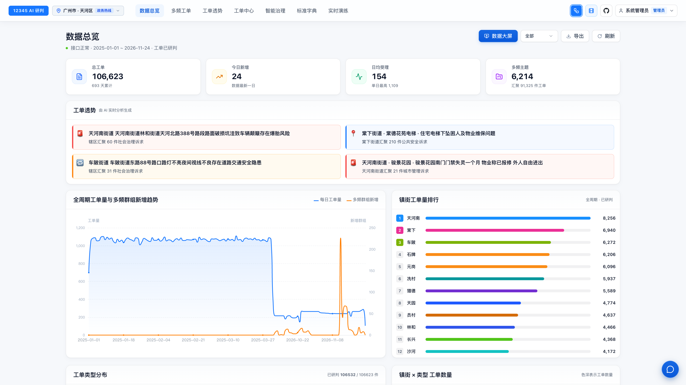

#### 全局组件 A · AI 研判流水线工厂抽屉（顶栏 Workflow 图标触发）
- 以 React Flow 可视化 **6 工序 DAG**：`01 工单接收与导入` → `02 分类初筛与分流`（含涉稳红线与加急件） → `03 地点与主体提取`（含节点探测延迟与提取进度条） → `04 同类问题聚合分析`（主题数与归集率） → `05 处置建议与案卷归档`（快捷键直达 `/screen`、`/sandbox`、`/multifreq`） → `06 协同处置与闭环回流`（待派单 / 处理中 / 已办结 / 假闭环拦截 / 待复核队列）。
- **关联 API**：`GET /api/workbench/pipeline-state`、`GET /api/cluster/progress`、`POST /api/tickets/upload`、`POST /api/tickets/paste`

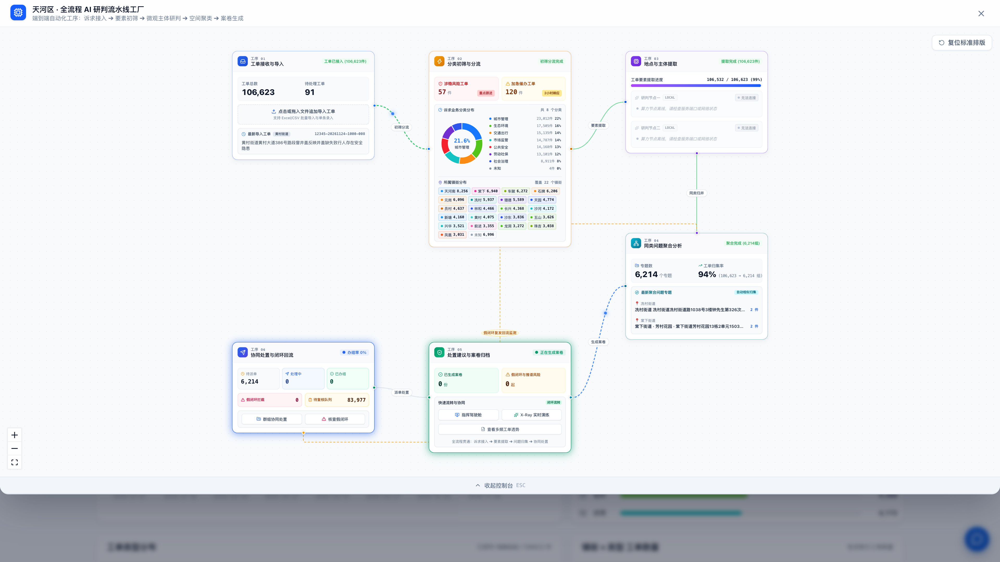

#### 全局组件 B · AI 研判副驾驶抽屉 (`LightCopilot`，顶栏「AI 研判」按钮或右下角悬浮气泡触发）
- **1 轮并行预取极速简报**：点击快捷问题「生成今日多频工单研判简报，汇总总量、高危主题与处置建议」时，服务端并行预取总览、高危主题与镇街指标后单轮直出 GFM 规范表格简报并支持一键导出 Markdown。
- **3 层出网 PII 防火墙**：`@civic/anonymizer` 会话脱敏 + `sanitizeMessagesForModel` + 云端 `scrubCloudPiiText` 清洗，保障原始个人隐私不出私域。
- **Human-in-the-Loop 提案卡**：工具层严格只读，涉及派单/升级/办结时输出可交互 `civic-action` 卡片，管理员点击「确认执行」才调用 `PATCH /api/clusters/[id]` 落库。
- **关联 API**：`POST /api/copilot`、`PATCH /api/clusters/[id]`

---

### 2. 市民/买家智能受理门户 (`/submit`)

- **访问权限**：所有已登录用户（普通市民/买家登录后默认落地页，也可由管理员从顶栏快捷访问体验）
- **核心模块与交互**：
  - **双模式填报切换**：默认「智能对话受理」，支持切换「传统表单填报」。
  - **3D 数字人「小蠢」+ 流式语音对话 (`VoiceChatComposer`)**：集成 `@firetable/project-xiaochun` 与 `@firetable/stream-asr`，支持点击麦克风实时语音转写（开麦自动打断数字人 TTS 播报防回声）。
  - **动态追问与结构化草稿卡**：AI 从口语描述中自动抽取分类、所属镇街/渠道、发生地点、涉事主体与联系方式，发现缺失要素时主动追问；手机/邮箱等敏感信息实时脱敏展示，支持点击字段微调后一键提交拿回执号。
  - **页底「我的投诉/客诉进度」**：实时查看本人历史工单 4 态进度；对已办结工单可一键点击 **「未解决，申请重开」** 发起假闭环申诉（置为 `REOPENED` 并标红直达管理员待派单置顶队列）。
- **关联 API**：`GET /api/intake/options`、`POST /api/intake/chat`、`POST /api/intake/submit`、`GET /api/intake/my-tickets`、`POST /api/intake/my-tickets/[id]/reopen`
- **双域差异**：政务版文案为「民生诉求提交与进度追踪」（采集镇街/地点/涉事方）；电商版自动切换为「售后客诉提交与进度追踪」（采集销售渠道/订单仓网/SKU 商品）。

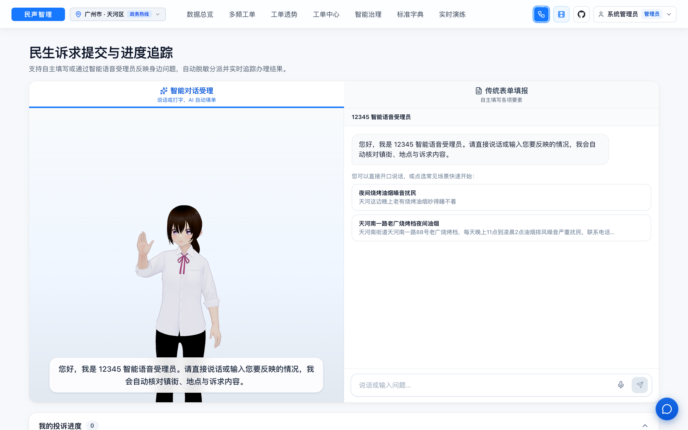

---

### 3. 工单中心 (`/tickets`) 与工单详情 (`/tickets/[id]`)

- **访问权限**：仅管理员
- **核心模块与交互（`/tickets` 列表页）**：
  - **4 大 KPI 与 9 个快捷筛选 Tab**：展示工单总数、今日新增、待派单与紧急工单；Tab 涵盖 `全部`、`待派单`（含 `REOPENED` 与假闭环三段索引置顶，0.25ms 响应）、`处理中`、`紧急`、`多频聚类`、`单发诉求`、**`缺资料`**（由数据库 `is_missing_info` 触发器 + 部分索引实时筛出）、**`疑似假闭环`** 与 **`待人工复核`**。
  - **行内「Agent 跟进」一键外呼补全**：对标记「缺资料」的未办结工单，直接点击行内「Agent 跟进」（或在右侧抽屉/详情页点击），自动创建或复用 `MISSING_INFO` 任务并弹出 **3D 小蠢语音外呼窗口 (`VoiceOutreachDialog`)**，支持语音或快捷回复模拟补充门牌与涉事主体并自动回写数据库与处置时间轴。
  - **多维检索与安全导出**：支持关键词（`pg_trgm` GIN 加速）、镇街/渠道、分类、聚类状态与时间筛选，支持防公式注入 CSV 导出。
- **核心模块与交互（`/tickets/[id]` 详情页）**：
  - 展示 AI 四要素解析卡片、诉求原文卡片、所属多频专题跳转、4 态统一操作按钮（`待派单 / 已派单 / 处理中 / 已办结`）、手工纠偏实体/分类并沉淀别名、以及完整审计 `处置时间轴`。
  - **管理员 PII 按需明文查验（留痕审计）**：工单列表与默认详情均返回脱敏值；管理员在详情页输入 **4–200 字查验事由** 后点击「申请查看明文（留痕审计）」，服务端先 Fail-Closed 写入 `public.pii_audit_logs` 再返回明文，明文仅在页面内存态临时展示（不落 `localStorage`），支持点击隐藏与折叠查看本单历史审计记录。
- **关联 API**：`GET /api/workorders`、`GET/PATCH /api/workorders/[id]`、`POST /api/workorders/[id]/reveal-pii`、`GET /api/admin/pii-audit`、`POST /api/agent/tasks`、`POST /api/agent/outreach/voice-turn`、`GET/PATCH /api/review`

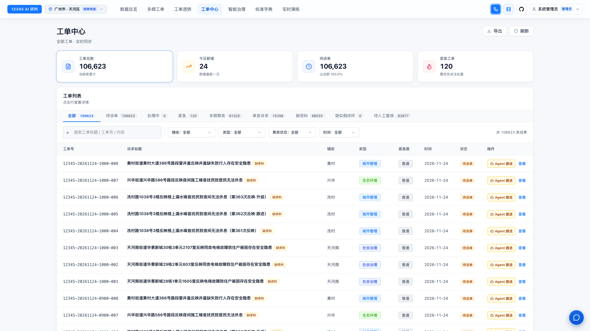

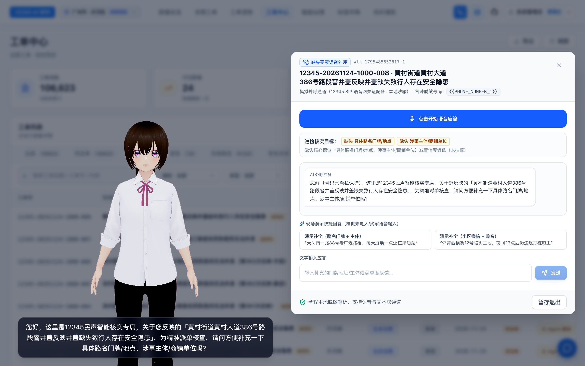

---

### 4. 智能治理中心 (`/agent`)

- **访问权限**：仅管理员
- **核心模块与交互**：
  - **一键主动巡检**：点击右上角「立即巡检」，幂等扫描当前工作区的缺资料工单、超期高危专题与待回访已办结事项。
  - **三级自治分权统计与队列**：
    - **`L1 自动执行` (`L1_AUTO`)**：双域超期催办（`SLA_OVERDUE`）与电商低风险缺资料补采（`MISSING_INFO`），自动推进并记入台账；
    - **`L2 人工审批` (`L2_APPROVAL`)**：政务缺资料语音外呼核实（`MISSING_INFO`）与双域 48h 满意度回访（`REOPEN_CALLBACK`），需人工点击「发起 AI 语音外呼」或「批准执行」才生效；
    - **`L3 红线熔断` (`L3_BLOCKED`)**：命中政务涉稳/重大安全红线或电商食安/12315 监管红线（`REDLINE_BLOCK`）时强制禁用 AI 自动外联，直接转人工核查专班接管。
  - **48h 满意度回访防假闭环**：对已办结事项发起回访，一旦市民/买家反馈问题未解决，自动将工单/专题重开并标红为 `疑似假闭环`。
  - **每日研判专报**：一键生成并持久化当前工作区 Markdown 治理专报（含 GFM 表格与下载导出）。
- **关联 API**：`GET/POST /api/agent/tasks`、`PATCH /api/agent/tasks/[id]`、`POST /api/agent/patrol`、`POST /api/agent/outreach/voice-turn`、`GET/POST /api/agent/report`

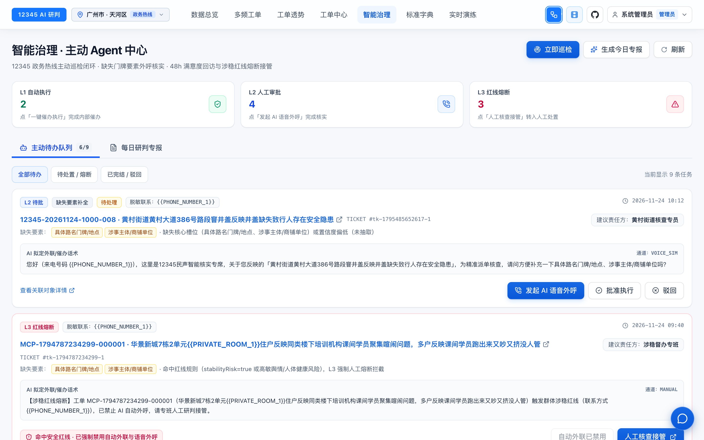

---

### 5. 多频工单 (`/themes`) 与多频专题详情 (`/themes/[id]`)

- **访问权限**：仅管理员
- **核心模块与交互**：
  - **`/themes` 列表页**：展示总群组数、今日新增、待派单、紧急群组 4 项 KPI；采用服务端分页与索引预排序（`?page=1&size=15&sort=story`），支持按 `群体聚集型 / 同主体发散型 / 时空热点型` 模式、镇街/渠道、紧急度及关键词检索，支持导出 CSV。
  - **`/themes/[id]` 专题详情页**：展示头部 AI 研判综合摘要与公文级处置建议（牵头单位、协办单位、时限、处置路径）、实体知识图谱拓扑可视化、全部成员工单穿透列表，以及 4 态处置动作（派单/推进/升级督办/办结/重开）与 `处置时间轴`。
- **关联 API**：`GET /api/clusters`、`GET/PATCH /api/clusters/[id]`、`GET /api/clusters/[id]/members`、`GET /api/graph`

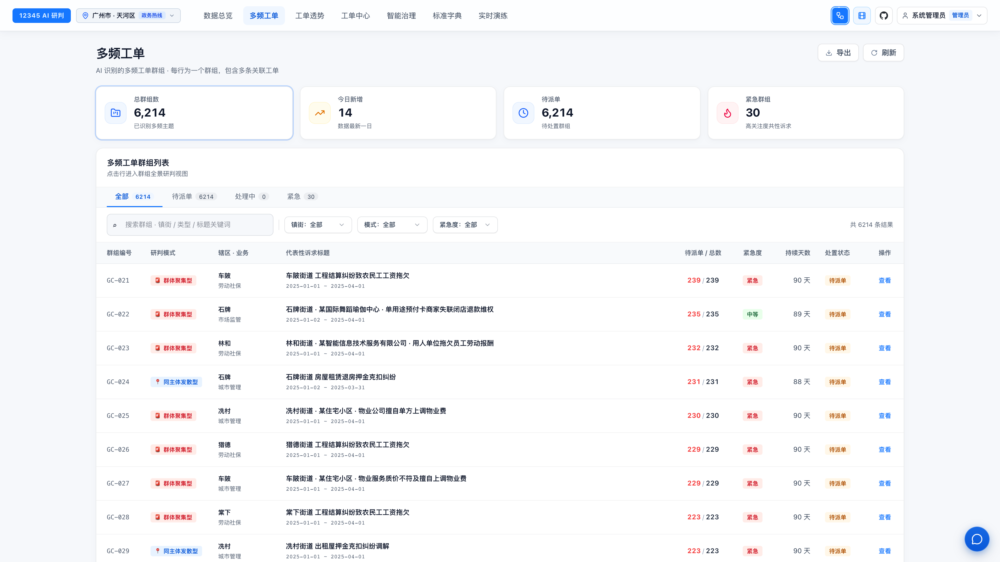

---

### 6. 工单透势 (`/multifreq`)

- **访问权限**：仅管理员
- **核心模块与交互**：
  - 使用 `/api/clusters?view=summary` 轻量摘要视图秒级加载（响应体积由数 MB 降至 zstd ~1.5KB）。
  - **空间 / 渠道热力图**：政务域基于天地图 CGCS2000 瓦片叠加法定镇街边界多边形与工单计数胶囊，支持点击镇街联动筛选；电商域切换为全渠道仓网热度矩阵。
  - **紧急 × 重要四象限矩阵**：将专题按紧急度与工单量分布至「紧急且重要」「重要不紧急」「快速处置」「观察等待」四个象限，展示各象限真实总数与 Top25 代表圆点（点击直钻详情）。
  - **TOP 5 多频聚类榜与置信度阈值切换**：支持按 `近 7 天 / 全部`、`置信度阈值` 动态筛选。
- **关联 API**：`GET /api/clusters?view=summary`、`GET /api/regions/[id]/boundary`、`GET /api/map/tile`

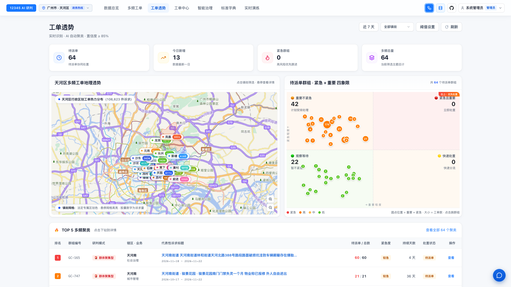

---

### 7. 标准字典与知识库 (`/dict`)

- **访问权限**：仅管理员
- **核心模块与交互**：
  - **4 项知识资产 KPI**：法定镇街总数（或渠道节点数）、覆盖村居/社区、分类体系、活跃别名映射数。
  - **AI 别名归一化即时替换演练（Live Sandbox）**：输入包含口语俗称/旧称的文本，实时对比归一化替换后的规范全称。
  - **四维 Tab 管理**：`别名知识库映射`（支持检索与手动新增/删除）、`空间地理坐标库 (Canonical)`（支持 Leaflet 地图打点预览与天地图地理编码）、`法定区划树` 与 `业务分类标准`。
- **关联 API**：`GET/POST/DELETE /api/dict`、`GET /api/map/geocode`

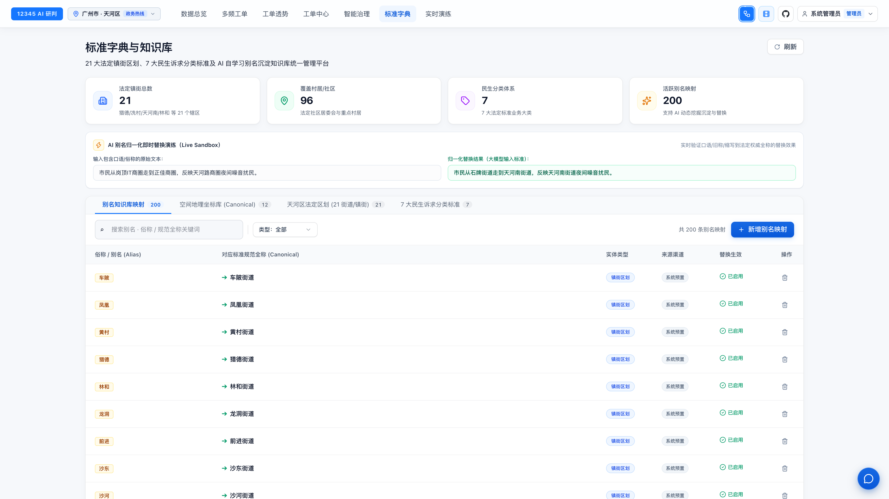

---

### 8. 全链路 AI 透视演练台 (`/sandbox`)

- **访问权限**：仅管理员
- **核心模块与交互**：
  - 严格默认只读不落库（`persist: false`），不污染线上工单基线计数。
  - **典型场景一键填充**：内置典型案例（主体违停精确对齐、口语俗称别名归一、已办结复发假闭环探测等），也可自由输入任意文本和选填标题/镇街。
  - **6 阶段端到端可观测拆解**：实时展示并记录耗时：`01 可逆脱敏 Diff` → `02 System-1 快思考神经引擎（4-Head ONNX + 11 类红线）` → `03 法定白名单与别名归一` → `04 System-2 慢思考结构化抽取` → `05 语义吸附与假闭环探测` → `06 反向脱敏还原与公文处置建议`。
- **关联 API**：`POST /api/sandbox/xray`

---

### 9. 政企智能调度指挥驾驶舱大屏 (`/screen`)

- **访问权限**：仅管理员（通过数据总览「数据大屏」按钮或直接访问 `/screen` 进入，支持全屏无顶栏 4K/8K 投屏）
- **核心模块与交互**：
  - **深色沉浸式布局**：顶部显示实时时钟、站点快捷切换、`实时流: 开启` SSE 连接指示、全屏按钮与 `退出 ESC`。
  - **顶部 4 指标条 + 五大态势板块**：今日受理总量、办结率、活跃多频群组、高风险群诉；分类占比环图、高风险群诉预警滚动、实时工单接入流水（LIVE STREAM）、中间暗色 CGCS2000 测绘热力底图（电商域为暗色全渠道仓网矩阵）、镇街/渠道态势排行榜、闭环处置全链路漏斗（接入→已研判→多频归集→派单→办结→假闭环拦截）、工单时序脉冲、24h 来电波峰与 System-2 研判节点实时节拍。
- **关联 API**：`GET /api/cockpit`、`GET /api/sse`、`GET /api/regions/[id]/boundary`

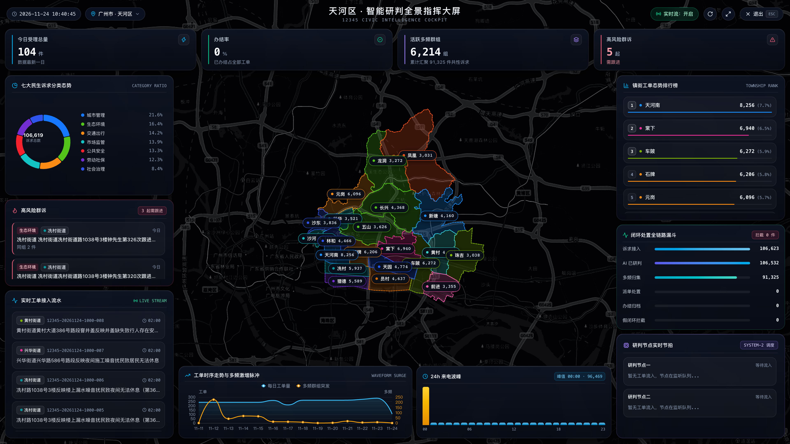

---

### 10. 站点纳管与多租户算力控制台 (`/admin/regions`)

- **访问权限**：仅管理员
- **核心模块与交互**：
  - **多租户站点管理**：查看各租户 Schema 物理空间（`region_{id}`）、工单/专题/词典体量、切换当前活动工作区、导入自定义行政边界或一键启动 **SuperAgent AI Scout** 30 秒创建并拓荒新城市站点。
  - **算力集群与 Colab GPU 热插拔管理**：查看环境变量只读基础节点，并可动态新增、启停、删除与实时探活远程 Colab / Tailscale / 云端 OpenAI 兼容 System-2 与 Embedding 节点。
  - **已接入 MCP Agent 管理**：查看并随时吊销已获 OAuth 授权接入的外部 MCP 客户端凭据。
- **关联 API**：`GET/POST /api/admin/regions`、`GET/PATCH/DELETE /api/admin/regions/[id]`、`POST /api/admin/regions/ai-scout`、`POST /api/admin/regions/[id]/fetch-boundary`、`POST /api/admin/regions/[id]/seed-vocab`、`POST /api/admin/regions/[id]/upload-map`、`GET/POST /api/admin/compute-nodes`、`PATCH/DELETE /api/admin/compute-nodes/[id]`、`POST /api/admin/compute-nodes/probe`、`GET/DELETE /api/admin/mcp-clients`

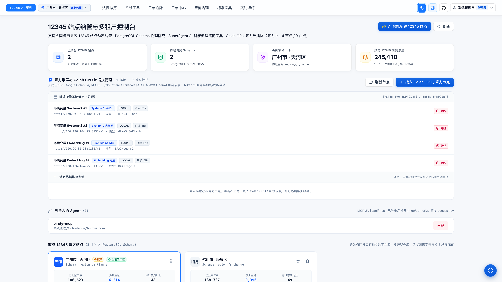

---

### 11. 统一认证门户 (`/login`) 与 MCP 授权页 (`/mcp/authorize`)

- **`/login`（公开访问）**：
  - **双模式切换**：支持「账号登录」（含 Better Auth `username` 插件，启用 5 分钟 HMAC 签名 `cookieCache` 免频繁回库）与「市民/买家体验注册」（2 秒自助创建普通角色账号并自动进入 `/submit`）。
  - **双域品牌自适应**：根据当前访问域（`GOV_12345` vs `ECOMMERCE_CS`）自动切换页面标题、特性标签与底部隐私声明；仅非生产或显式开启演示提示时展示本地快捷填充通道。
- **关联 API**：`/api/auth/[...all]`

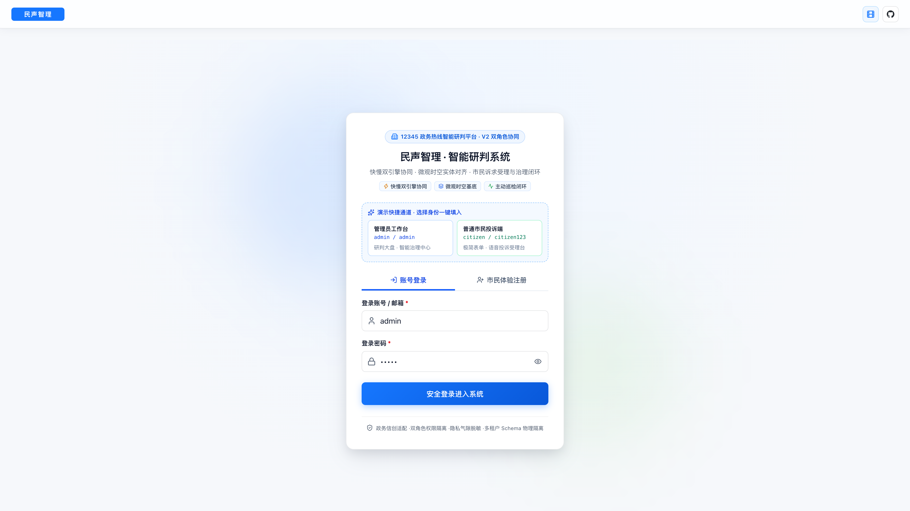

- **`/mcp/authorize`（需登录）**：
  - 为 Claude Desktop、Cursor、OpenClaw 等外部 MCP 客户端提供标准化 OAuth 2.0 授权确认界面；配合根目录 `/.well-known/oauth-protected-resource` 与 `/.well-known/oauth-authorization-server` 完成无配置发现与 Token 签发。
  - **关联 API**：`POST /api/mcp/grant`、`POST /api/mcp/token`、`POST /api/mcp`

---

## 三、跨行业电商客诉独立站对照表

独立部署于 https://ecom.firetable.tech （容器 `12345-ecom-app`，`APP_DOMAIN=ECOMMERCE_CS`），复用同一套生产镜像 `ticket-radar:v0.1.7` 与底层认知引擎，全站界面与规则自适应差异如下：

| 维度 | 政务 12345 主站 (`12345.firetable.tech`) | 电商售后客诉站 (`ecom.firetable.tech`) |
| :--- | :--- | :--- |
| **空间 / 地理视图** | 启用天地图 CGCS2000 + 法定镇街矢量底图 (`hasGeoMap: true`) | 自动切换为 **全渠道 / 仓网客诉热度分布矩阵** (`hasGeoMap: false`) |
| **核心术语体系** | 所属镇街 · 涉事主体 · 民生工单 · 牵头部门 · 多频研判专题 | 渠道/仓网 · 涉事 SKU/商品 · 售后客诉单 · 负责团队 · 多频客诉案卷 |
| **分类标签池** | 城市管理 / 市场监管 / 社会治理 / 交通出行 / 生态环境 / 劳动社保 / 公共安全 | 商品质量 / 物流履约 / 退换售后 / 虚假宣传 / 价格促销 / 服务态度 / 食品安全 |
| **缺资料判定 (`is_missing_info`)** | 缺路名门牌或涉事商铺单位或镇街 | 额外强制校验订单/仓网地址长度 `<= 6` 或缺少具体 SKU |
| **L1/L2 自治策略** | 缺资料补全需 **L2 人工审批**；超期催办 L1 自动执行 | 低风险缺资料补全与催办 **L1 自动执行**；48h 赔付回访仍 L2 人工审批 |
| **L3 红线熔断规则** | 11 类涉稳/群访/重大安全险情红线 | 食品安全中毒 / 12315 监管举报 / 社媒大规模舆情红线 |

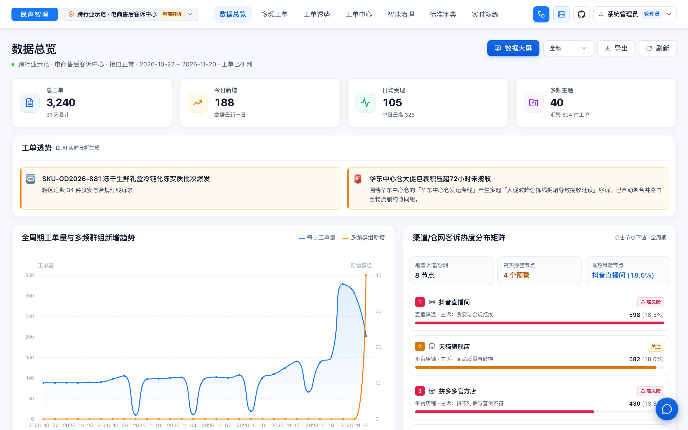
