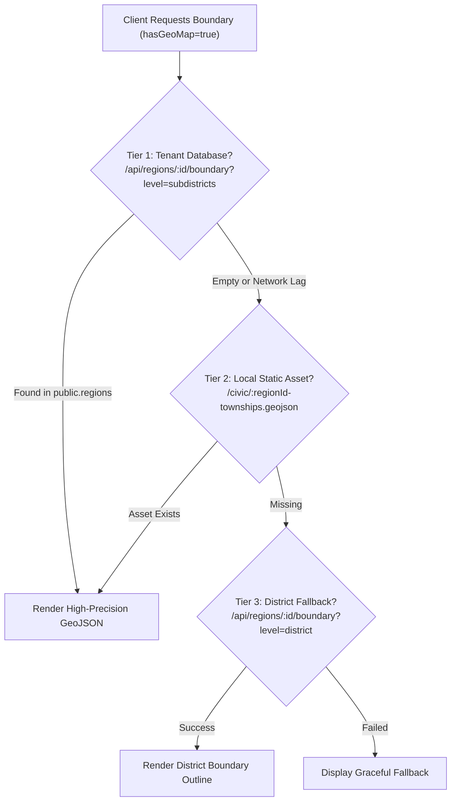

# CivicRadar Spatial, Geo-Location & Dual-Domain Matrix Architecture Guide

> **Civic Intelligence (民声智理) · 12345 Public Hotline Cognitive Engine & AI Workflow**  
> Spatial computing, multi-tier administrative division mesh, zero-drift CGCS2000 GIS visualization, and `hasGeoMap` dual-domain switching (Government GIS vs. E-Commerce Channel & Warehouse Matrix).

---

## Table of Contents
1. [Executive Summary](#1-executive-summary)
2. [Dual-Domain `hasGeoMap` Switching (Gov GIS vs. E-Commerce Matrix)](#2-dual-domain-hasgeomap-switching-gov-gis-vs-e-commerce-matrix)
3. [Multi-Tier Spatial Data Hierarchy (`public/civic/*.geojson`)](#3-multi-tier-spatial-data-hierarchy-publiccivicgeojson)
4. [Coordinate Reference Systems (CRS) & Pixel-Perfect Alignment](#4-coordinate-reference-systems-crs--pixel-perfect-alignment)
5. [Front/Back Separation, Hardened Tile Proxy & `lib/map/` Modules](#5-frontback-separation-hardened-tile-proxy--libmap-modules)
6. [Geo-Location in the AI Agent Pipeline](#6-geo-location-in-the-ai-agent-pipeline)
7. [Visualization & UX Ergonomics Standards](#7-visualization--ux-ergonomics-standards)
8. [API & Data Schema Reference](#8-api--data-schema-reference)
9. [Geo-Spatial Indexing & GEO/SEO Standards](#9-geo-spatial-indexing--geoseo-standards)

---

## 1. Executive Summary

CivicRadar treats spatial/topological structure as an **active dimension of incident reasoning, operational routing, and domain adaptation**:

- **Incident-to-Grid Binding (`GOV_12345`)**: Translates unstructured conversational citizen reports into structured CGCS2000 coordinates and statutory 4th-level subdistrict grids (镇街/街道).
- **Dual-Domain Topology Adaptation (`hasGeoMap`)**: Driven by `DomainProfile.hasGeoMap` (`lib/domain-profile.ts`), government hotlines (`12345.firetable.tech`) render interactive Leaflet + Tianditu choropleth maps, while standalone e-commerce CS instances (`ecom.firetable.tech`) seamlessly switch to the **Omni-Channel & Warehouse Pressure Matrix (`DomainChannelMatrix`)** with zero GIS tile or geocode overhead.
- **Spatial Semantic Clustering**: Combines micro-spatial entity cleansing with `BAAI/bge-m3` embeddings to converge localized recurring incident clusters (多频高发群组).

---

## 2. Dual-Domain `hasGeoMap` Switching (Gov GIS vs. E-Commerce Matrix)

Each tenant stores a `DomainProfile` inside `public.regions.category_config_json` (parsed by `parseDomainProfile()` in `lib/domain-profile.ts`):

| Domain (`domainType`) | Production Instance | `hasGeoMap` | Spatial / Topological Visualization |
| :--- | :--- | :---: | :--- |
| **`GOV_12345`** | `https://12345.firetable.tech` (`12345-app`) | `true` | Leaflet + Tianditu CGCS2000 basemap, 4th-level subdistrict GeoJSON choropleth (`CivicGeoMap` / `CockpitMap`), and per-ticket geo-pin card (`TicketGeoMapCard`). |
| **`ECOMMERCE_CS`** | `https://ecom.firetable.tech` (`12345-ecom-app`) | `false` | Disables all GIS tile/geocode fetches; renders **`DomainChannelMatrix`** (`app/_components/civic/domain-channel-matrix.tsx`) across Cockpit (`/screen`) and Trend Analysis (`/multifreq`), and hides `TicketGeoMapCard` in Ticket Detail / Drawer (`/tickets`). |

### `DomainChannelMatrix` Capabilities (`hasGeoMap: false`)
- **Node Classification**: Automatically classifies tenant `subdistrict` / channel nodes into **平台店铺** (`store`: 天猫旗舰店, 京东自营店, 拼多多官方店), **直播渠道** (`live`: 抖音直播间), and **仓配节点** (`warehouse`: 华南冷链仓, 华东中心仓, 华北分拨仓, 跨境保税仓).
- **Risk & Share Highlighting**: Highlights high-risk complaint nodes based on volume share (`>= 18%`), multi-frequency cluster density (`>= 4`), or high-risk category ratio (`>= 25%` for `食安与合规红线` / `假冒伪劣与欺诈`).
- **Dual Visual Variants**: Supports Civic Light (`variant="light"`, used in `/multifreq`) and dark Obsidian (`variant="dark"`, used in `/screen` cockpit).
- **Cluster API Alignment**: `app/api/clusters/route.ts` reads `domainProfile.hasGeoMap` to keep facet labels and regional filters aligned with townships (`hasGeoMap: true`) or channels/warehouses (`hasGeoMap: false`).

---

## 3. Multi-Tier Spatial Data Hierarchy (`public/civic/*.geojson`)

### 3.1 Fourth-Level Administrative Polygon Mesh (Subdistricts)
For `GOV_12345` tenants, CivicRadar standardizes on the **4th statutory administrative level** (Township / Subdistrict):
- **Guangzhou Tianhe District (`gz_tianhe`)**: 21 official subdistricts (`~106.5k` tickets).
- **Foshan Shunde District (`fs_shunde`)**: 10 official townships/subdistricts (`~138.7k` tickets).

### 3.2 Canonical Local Static Assets (`public/civic/`)
Verified static GIS assets shipped in `/public/civic/`:
- `public/civic/gz_tianhe-townships.geojson` (Guangzhou Tianhe Subdistrict Mesh)
- `public/civic/fs_shunde-townships.geojson` (Foshan Shunde Subdistrict Mesh)

### 3.3 Three-Tier Resilient Boundary Fallback Strategy


---

## 4. Coordinate Reference Systems (CRS) & Pixel-Perfect Alignment

### 4.1 The Coordinate Drift Problem in China
| Coordinate System | Authority / Platform | Characteristics | Non-linear Encryption Shift |
| :--- | :--- | :--- | :--- |
| **WGS-84 / CGCS2000** | National Geomatics Center of China (Tianditu), Gov GeoJSON | Standard geodetic ellipsoid | **0 meters (True Coordinates)** |
| **GCJ-02 ("Mars Coordinates")** | AutoNavi (Amap), Tencent | Obfuscated via national algorithm | **300m ~ 500m offset** |
| **BD-09** | Baidu Maps | Secondary obfuscation on top of GCJ-02 | **400m ~ 800m offset** |

### 4.2 Resolution: Strict CGCS2000 Alignment
CivicRadar strictly aligns GeoJSON boundaries and enterprise/incident geocodes with **Tianditu CGCS2000 base layers**, ensuring zero drift between rivers, roads, bridges, and subdistrict boundaries.

---

## 5. Front/Back Separation, Hardened Tile Proxy & `lib/map/` Modules

```text
┌────────────────────────────────────────────────────────────┐
│            Client Browser (Leaflet, hasGeoMap=true)         │
└──────┬─────────────────────────────────────────────┬───────┘
       │                                             │
       │ ① Raster Tiles (/api/map/tile)              │ ② Boundaries & Geocoding
       │   In-memory 1000-tile LRU + 30d immutable   │   (/api/regions/:id/boundary, /api/map/geocode)
       ▼                                             ▼
┌────────────────────────────┐               ┌────────────────────────────┐
│  Hardened Tile Proxy Route │               │  Next.js Server Backend    │
│  type whitelist + z/x/y    │               │  requireAdmin on geocode   │
│  bounds + image/* check    │               │  vocabularies LOCATION DB  │
└──────────────┬─────────────┘               └─────────────┬──────────────┘
               │                                           │
               └──────────────► TIANDITU_SERVER_KEY ◄──────┘
                                       ▼
                        ┌────────────────────────────┐
                        │ Tianditu National API Gate │
                        │ (WMTS Tiles / Geo / POI)   │
                        └────────────────────────────┘
```

### 5.1 Core `lib/map/` Module Inventory
| File | Key Exports | Responsibility |
| :--- | :--- | :--- |
| [`lib/map/boundary-service.ts`](../lib/map/boundary-service.ts) | `KNOWN_DISTRICT_ADCODES`, `fetchDistrictBoundary` | Fetches district/subdistrict GeoJSON boundaries for existing & AI-Scouted tenants. |
| [`lib/map/tianditu-service.ts`](../lib/map/tianditu-service.ts) | `geocodeAddress`, `reverseGeocode`, `getTiandituTileUrl` | Server-side Tianditu forward/reverse geocoding and WMTS URL builder (`vec` / `cva` / `img` / `cia`) using `TIANDITU_SERVER_KEY`. |
| [`lib/map/tile-layer.ts`](../lib/map/tile-layer.ts) | `getTiandituTileUrls` | Provides client-side proxy tile URL templates pointing to `/api/map/tile`. |
| [`lib/map/client-geocode.ts`](../lib/map/client-geocode.ts) | `geocodeAddressClient`, `runWithConcurrency`, `isValidCoordinate` | Client geocode helper with bounded concurrency and coordinate validity checks. |
| [`lib/map/enterprise-address-enricher.ts`](../lib/map/enterprise-address-enricher.ts) | `PLACEHOLDER_LOCATIONS`, `isPlaceholderLocation`, `isEnterpriseEntity`, `enrichEnterpriseLocation` | Detects placeholder locations and enriches named enterprise subjects with real addresses. |

### 5.2 Hardened Tile Proxy & Geocode Security (`app/api/map/`)
1. **Map Tile Proxy (`GET /api/map/tile`)**:
   - Strict `ALLOWED_TILE_TYPES` whitelist (`vec`, `cva`, `img`, `cia`), integer `z` (`0..18`) and `x`/`y` (`0..2^z - 1`) bounds checks;
   - Upstream fetch enforces a `6s` `AbortSignal.timeout`, verifies `Content-Type: image/*`, and caps tile payload at `5 MB`;
   - Server-side in-memory LRU cache (`MAX_TILE_CACHE = 1000`, `X-Tile-Cache: HIT`) + browser response header `Cache-Control: public, max-age=2592000, immutable` (30 days);
   - `TIANDITU_SERVER_KEY` is read exclusively on the server and never exposed to client bundles.
2. **Geocode Route (`POST /api/map/geocode`)**:
   - Protected by `requireAdmin(req)` (never exposed anonymously);
   - Supports `mode: "forward"` and `mode: "reverse"` with strict coordinate & string length validation (`<= 128` chars);
   - Persists resolved coordinates in tenant `vocabularies` (`type = 'LOCATION'`, deterministic `LOC-<sha256>` ID) to avoid redundant upstream API calls.

---

## 6. Geo-Location in the AI Agent Pipeline

1. **Spatial Core Cleansing (`extractSpatialCore`)**: Strips room numbers, floor suffixes, and noisy modifiers while preserving canonical road/community/village cores (e.g., `"大良街道金榜上街28号门前沿街商铺"` → `"大良街道金榜上街"`).
2. **Reverse Township Imputation (`legalTownshipName`)**: Maps landmark/community mentions against tenant `vocabularies` and `aliases` dictionaries (`lib/vocabulary.ts`) to resolve statutory subdistricts (`清晖园门前` → `大良街道`, `太古汇北门` → `天河南街道`).
3. **Anti-Hallucination Barrier (`isSameSpatialEntity`)**: Prevents merging unrelated incidents across distinct road sections or administrative-only generalities (`RULES.adminOnlyLocation`).

---

## 7. Visualization & UX Ergonomics Standards

1. **SSOT Palette**: Township colors are centrally derived via `getTownshipColor(name)` in `lib/civic-cluster.ts` across choropleth maps, tables, and charts.
2. **Centroid Micro-Badge Anchoring & Non-Scaling Stroke**: Subdistrict labels stay anchored to polygon geometric centroids; `vector-effect: non-scaling-stroke !important;` avoids stroke explosion while zooming.
3. **Lifecycle & XSS Hardening**:
   - Leaflet components lazy-load `leaflet.css` on demand (no longer bloating root layout CSS) and guard against React StrictMode / pre-region unmount races (`6ef9866`);
   - All dynamic text injected into Leaflet popups and tooltips is HTML-escaped to eliminate XSS (`3201339`).

---

## 8. API & Data Schema Reference

### 8.1 Database Schema Columns (`public.regions`)
```sql
ALTER TABLE public.regions
  ADD COLUMN IF NOT EXISTS geojson_boundary text,      -- District Level Boundary
  ADD COLUMN IF NOT EXISTS subdistricts_geojson text;  -- 4th-Level Subdistrict Mesh
```

### 8.2 Core Spatial Endpoints
| Method | Route | Auth | Description |
| :--- | :--- | :---: | :--- |
| `GET` | `/api/regions/:id/boundary?level=subdistricts` | Public | Retrieves 4th-level subdistrict polygon mesh |
| `GET` | `/api/regions/:id/boundary?level=district` | Public | Retrieves 3rd-level district outline polygon |
| `POST` | `/api/admin/regions/:id/fetch-boundary` | Admin | Fetches and persists boundaries via `boundary-service.ts` |
| `POST` | `/api/admin/regions/:id/upload-map` | Admin | Uploads custom GeoJSON/SVG boundary assets (with safe SVG preview) |
| `POST` | `/api/map/geocode` | Admin | Forward/reverse geocoding with `vocabularies` (`LOCATION`) caching |
| `GET` | `/api/map/tile?type=vec\|cva\|img\|cia&z=:z&x=:x&y=:y` | Public | Hardened & LRU-cached Tianditu CGCS2000 tile proxy |

---

## 9. Geo-Spatial Indexing & GEO/SEO Standards

- **Schema.org & Geographic Metadata**: Emits `GovernmentService` / `SoftwareApplication` JSON-LD and standard `geo.region` / `geo.placename` / `geo.position` metadata in the root layout.
- **`/llms.txt` Dynamic Manifest**: [`app/llms.txt/route.ts`](../app/llms.txt/route.ts) dynamically serves `/llms.txt` with canonical dual-domain architecture, System-1/2 dual-engine specs, Tianditu CGCS2000 standards, and MCP endpoints in clean Markdown.
- **Dynamic Robots & Sitemap**: `app/robots.ts` shields `/admin/` and `/mcp/authorize` while exposing public analytics routes; `app/sitemap.ts` registers core routes dynamically.
