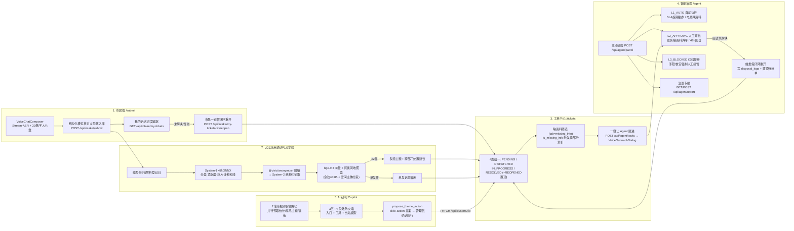
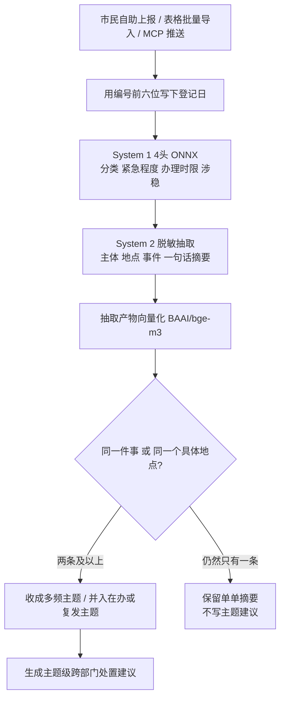

# 12345 政务热线智能工单研判平台 · AI 工作流与全闭环演进规范 (V2 Production)

> **核心研判准则**：每条工单前置通过双系统（System 1 毫秒级意图定性 + System 2 结构化要素抽取）协同解析；抽取实体产物融合语义与时空特征统一向量化（`BAAI/bge-m3`）；严格基于“同案同地”高阶判定收拢群诉主题；多频群组动态派生跨部门协同处置预案；并通过 **市民端 `/submit` → 工单中心 `/tickets` → 智能治理 `/agent` → AI 研判 Copilot** 形成完整的全生命周期闭环治理链路。

---

## 零、架构演进全景：V1 与 V2 核心流程深度对比 (Architecture Evolution)

### 0.1 演进背景与设计哲学

在 12345 等超大规模城市政务热线及全渠道客诉场景中，工单数据具备**海量突发、诉求表述离散、空间粒度微观、处置责任法定、易发假闭环与缺资料阻滞**等复杂特征。
- **系统 V1 痛点**：早期版本基于“单一通用大模型 + 粗粒度时空图割裂”构建，存在算力开销畸高、低置信度死循环仲裁、跨街道泛化诉求误聚、单一城市硬编码，以及仅停留在“被动看板分析”而缺乏市民闭环与主动治理外呼等瓶颈。
- **系统 V2 突破**：引入认知科学“快慢双系统（Kahneman Dual-System）”理论，结合端侧 ONNX 分类器、高精度 GIS / 仓网矩阵、多租户双域隔离、分级自治治理 Agent 与全栈读性能调优，形成**“语音自助受理 + 毫秒初筛 + 深度抽取 + 时空语义收敛 + 主动外呼补全/回访 + 人在回路副驾驶”**的工业级闭环中枢。

### 0.2 全闭环业务拓扑流转图



### 0.3 全维度架构升级对照矩阵

| 架构维度 | V1 (历史基线) | V2 (现行生产架构) | 核心业务收益与技术亮点 |
| :--- | :--- | :--- | :--- |
| **认知决策范式** | 单一粗粒度 LLM 贯穿全流程 | **System 1 (快) + System 2 (慢) 双系统协同** | 毫秒级端侧分类与深度语义抽取分离，算力节约 80%+ |
| **分流与红线护栏** | 100% 无差别请求大模型 | **端侧 4-Head ONNX + 符号红线互锁** | 意图、7 分类、紧急度、SLA 与涉稳前置落库，红线单自动熔断 |
| **隐私安全治理** | 单向正则简单掩码 | **`@civic/anonymizer` 可逆脱敏 + Copilot 3 层 PII 防火墙** | 入口、工具、出站模型三重脱敏，全链路零明文 PII 越界 |
| **群诉聚类算法** | 静态 72h 宽泛时空图割裂 | **`BAAI/bge-m3` 向量 (默认 `PRODUCT_COSINE_MIN=0.85`) + 微观空间基底提纯** | 严格同案同地收敛，跨街道误聚率清零，支持办结复发吸纳 |
| **全链路闭环** | 仅停留在只读统计大盘 | **市民 `/submit` + 缺资料一键 Agent 外呼 + `/agent` L1/L2/L3 + 48h 回访 + Copilot `civic-action`** | 从受理、补全、派单到防假闭环全周期可追溯、可审计 |
| **多业务域与空间** | 单一顺德静态硬编码 | **Schema 物理隔离 + `APP_DOMAIN` 双域名同镜像 + `hasGeoMap` 双模切换** | 政务域启用天地图 CGCS2000 四级镇街图；电商域切全渠道仓网矩阵 |
| **高并发读性能** | 实时全表扫描 + 6.8MB 全量 JSON | **`0011`/`0012` 覆盖/部分/触发器索引 + SWR 缓存 + Better Auth `cookieCache` + `/api/clusters` 瘦身** | 消除正则全表扫描与 CASE 排序，`/api/clusters` 传输体积下降 **-99.8%** |
| **开放互联生态** | 封闭内部系统 | **原生 MCP (`2025-03-26`) + RFC 9728/8414 OAuth 发现** | 支持政务与电商双域名按 `APP_DOMAIN` 隔离对外开放 |

---

## 一、一条工单怎么走 (研判核心流水线)



图的实现顺序在 [`backend/agent/ticket-agent.ts`](../backend/agent/ticket-agent.ts)：抽取、对齐、聚类、主题建议。批量入口为 [`lib/cluster-job.ts`](../lib/cluster-job.ts) 的 `executeClusterJob`。

---

## 二、研判核心各步做什么

### 1. 登记日：`lib/work-order-date.ts`
`250101000770102-01` 拆分为四段：`250101`（年月日 `2025-01-01`）、`000770`（受理序号）、`102`（事项代码）、`-01`（重办序号）。登记时间记亚洲/上海时区当天 **00:00**；编号无法解析时才回退取正文时间，非法日期直接放弃。

### 2. System 1：每条都跑
位于 [`packages/civic-system-one`](../packages/civic-system-one/) 与 [`backend/node/extract-node.ts`](../backend/node/extract-node.ts)：
- 四个头：意图、7 大分类、紧急程度、涉稳风险（含 `redline.ts` 符号红线互锁）；
- 写入 `source_category`、`urgency`（`NORMAL` / `MEDIUM` / `URGENT`，涉稳或 3 级置 `URGENT`）、`sla_hours`（0/120/24/2）、`stability_risk`；
- 共享模型不带具体城市的镇街，镇街输出恒为 `UNKNOWN`（不写入数据库）。

### 3. System 2：每条都抽实体并写摘要
- 本地 Bonsai 2 27B 或云端回退模型，抽取时统一关闭思考（`enableThinking: false`），输出 `canonical_subject`、`address`、`event_type`、`summarize_title`；
- [`backend/prompt.ts`](../backend/prompt.ts) 在 Zod 校验前把 `null`/`无`/`未知` 收成空串，主体抽空时置信度上限压至 `55`；低于 `60` 推入 `review_queue` 待人工复核；
- 出站前统一经 [`@civic/anonymizer`](../packages/civic-anonymizer/) 掩码姓名、手机、证件号、车牌等 PII，返回后按会话 Keymap 还原。

### 4. 对齐与聚类
- [`backend/node/canonical-node.ts`](../backend/node/canonical-node.ts)：按辖区 `aliases` 与 `vocabularies` 归一化主体和地点写法；
- [`backend/embed-products.ts`](../backend/embed-products.ts) + [`backend/same-incident-cluster.ts`](../backend/same-incident-cluster.ts) + [`backend/node/cluster-node.ts`](../backend/node/cluster-node.ts)：使用 `BAAI/bge-m3` 向量化抽取产物（写入 `ticket_embeddings` `halfvec(1024)`）；
- 同案同地合并满足其一：`incidentsMatch` 判定同案，或稠密产物向量余弦达到 `PRODUCT_COSINE_MIN`（默认 **0.85**，支持环境变量覆盖）且分类、具体地点/具名主体及镇街规则满足无冲突约束；
- 增量单条走 [`backend/incremental-cluster.ts`](../backend/incremental-cluster.ts)：支持毫秒级吸附已有主题（含已办结主题复发并触发假闭环标识），未命中时与近期历史落单工单联合计算，满 2 件自适应成新主题。

### 5. 主题级处置建议与共享 LLM 池
- [`backend/node/summary-node.ts`](../backend/node/summary-node.ts) 仅针对 ≥2 件的多频主题生成跨部门协同处置建议（每批 10 个主题，`THEME_ADVICE = 6144` token）；
- [`backend/node/advice-backfill.ts`](../backend/node/advice-backfill.ts) 为空缺建议的主题幂等补齐，不改成员、不删主题；
- 批处理任务共享 [`backend/llm-pool.ts`](../backend/llm-pool.ts) 并发池，并拆分为 `interactive` 与 `batch` 双通道，防止批量作业饿死交互式请求。

---

## 三、全链路治理闭环（现行生产核心路径）

### 3.1 市民端自助受理与防假闭环重开（`/submit`）
- **统一语音/文字输入**：采用 [`VoiceChatComposer`](../app/_components/civic/voice-chat-composer.tsx) 统一承载键盘输入与浏览器端侧实时流式语音转写（`@firetable/stream-asr` + [`use-stream-asr.ts`](../app/_hooks/use-stream-asr.ts) + `public/civic/asr-worklet.js`），支持边说边转写、发送前直接编辑核对；
- **3D 数字人「小蠢」协同受理**：集成 `@firetable/project-xiaochun`（[`XiaochunStage`](../app/_components/agent/xiaochun-stage.tsx)），支持 EMAGE 动作预加载、语音播报，并在开启麦克风时自动打断 TTS 播报防回声；
- **双模式建单与槽位校验**：支持对话式多轮追问（`POST /api/intake/chat`）与结构化表单直填两种模式，按当前站点 `DomainProfile` 自动切换镇街/渠道选项（`GET /api/intake/options`），校验手机或邮箱至少一项可达联系方式后提交 `POST /api/intake/submit`，脱敏入库并写入 `public.citizen_submissions` 归属记录；
- **我的诉求追踪与市民假闭环重开**：市民通过 `GET /api/intake/my-tickets` 查看本人工单流转状态与最新处置日志；若管理员标为「已办结」但实际未解决，市民可一键触发 `POST /api/intake/my-tickets/[id]/reopen`（`reopenCitizenTicket`），将工单状态置为 `REOPENED`、标记 `is_fake_closure = true`、写入 `disposal_logs`，并在管理员 `/tickets` 待派单队列中优先置顶。

### 3.2 工单中心 4 态统一与缺资料外呼闭环（`/tickets`）
- **4 态统一状态模型**（[`lib/civic-dto.ts`](../lib/civic-dto.ts)）：
  - `PENDING`（待派单）→ `DISPATCHED`（已派单）→ `IN_PROGRESS`（处理中）→ `RESOLVED`（已办结）；
  - 另含 `REOPENED`（假闭环重开态），在 `tab=pending` 视图中通过 `app/api/workorders/route.ts` 的 `fetchPendingOrderedPage()` 三段索引归并（`REOPENED` → `PENDING & is_fake_closure` → 普通 `PENDING`）优先置顶。
- **9 大筛选视图**：`全部`、`待派单`、`处理中`、`紧急`、`多频聚类`、`单发诉求`、`缺资料`（`tab=missing_info`）、`疑似假闭环`（`tab=fake_closure`）、`待人工复核`（`tab=review`）。
- **缺资料精准定位与「一键让 Agent 跟进」**：
  - 列表筛选直接查询 `0012_perf_indexes.sql` 维护的 `is_missing_info = true` 部分索引（`idx_tickets_missing_info_ct`），精准定位缺失具体地址/订单明细、主体为通用泛化词或缺失镇街/仓网的未办结工单；
  - 管理员在工单详情抽屉点击「一键让 Agent 跟进」，前端调用 `POST /api/agent/tasks`（`createOrReuseMissingInfoTask`）幂等创建或复用 `MISSING_INFO` 任务，并立即弹出 [`VoiceOutreachDialog`](../app/_components/agent/voice-outreach-dialog.tsx)；
  - 对话回合提交至 `POST /api/agent/outreach/voice-turn`（`processAgentVoiceTurn`），自动解析市民补充的地点/主体/镇街槽位，回写 `tickets` 表与 `disposal_logs`；PostgreSQL `BEFORE UPDATE` 触发器 `trg_tickets_sync_missing_info` 同步将 `is_missing_info` 置为 `false`，实现缺资料即时清零。
- **管理员按需明文查验与留痕审计（`revealPII` / `pii_audit`）**：
  - 在工单详情页（[`app/tickets/[id]/ticket-detail-client.tsx`](../app/tickets/[id]/ticket-detail-client.tsx)）仅对管理员提供「申请查看明文（留痕审计）」入口；提交 4–200 字查验事由后调用 `POST /api/workorders/[id]/reveal-pii`（严格 `requireAdmin`：未登录 401 / 普通用户 403），采用 **Fail-Closed** 机制先向 `public.pii_audit_logs`（[`db/migrations/0013_pii_audit_logs.sql`](../db/migrations/0013_pii_audit_logs.sql)）落库留痕，再返回原始 `callerName`/`callerPhone`/`address`/`rawContent`；
  - 全部明文与审计响应强制附带 `Cache-Control: no-store`，前端仅在当前页面内存态展示、绝不写入 `localStorage`；审计流水可通过 `GET /api/admin/pii-audit`（支持 `regionId` / `ticketId` / `actorUserId` / `limit`）回溯核查，且与出网 LLM 3 层 PII 脱敏防火墙完全解耦、零削弱。

### 3.3 智能治理中心：L1/L2/L3 分级自治、48h 回访与治理专报（`/agent`）
核心引擎位于 [`lib/agent-governance.ts`](../lib/agent-governance.ts)，对应页面 [`app/agent/agent-client.tsx`](../app/agent/agent-client.tsx)：
- **自主巡检与分级自治队列**（`POST /api/agent/patrol` → `runAgentPatrol`，`NOT EXISTS` 幂等去重）：
  | 任务类型 (`task_type`) | 自治分级 (`autonomy_level`) | 触发条件与处置策略 |
  | :--- | :--- | :--- |
  | **`SLA_OVERDUE`** | `L1_AUTO`（自动执行） | 高聚集且仍处于 `PENDING` 的多频主题，自动生成超期催办通知与建议承办单位 |
  | **`MISSING_INFO`** | 政务 `L2_APPROVAL` / 电商 `L1_AUTO` | 未办结工单缺少具体地点、具名主体或镇街/仓网，发起语音/对话外呼补全 |
  | **`REOPEN_CALLBACK`** | `L2_APPROVAL`（人工审批） | 已办结主题/工单触发 **48 小时满意度抽查回访**，核验现场整改是否属实 |
  | **`REDLINE_BLOCK`** | `L3_BLOCKED`（红线熔断） | 命中涉稳、极端事件、食安变质/假冒/12315 等红线词，严格禁止自动外呼或自动办结，强制人工接管 |
- **48h 回访假闭环重开**：在 `REOPEN_CALLBACK` 外呼交互（`POST /api/agent/outreach/voice-turn`）中内置否定词感知情感与整改核验逻辑（规则绝不误判为正向满意）；一旦市民反馈未解决或复发，自动置位 `triggeredFakeClosure`，重开对应工单与主题（`status = 'REOPENED'`、`is_fake_closure = true`）并写入审计日志。
- **治理专报**：`GET / POST /api/agent/report` 汇总当期总量、高危多频、缺资料、假闭环与红线拦截态势，生成结构化 Markdown 专报并持久化至 `<schema>.agent_reports`。

### 3.4 AI 研判 Copilot：1 轮简报预取 + 3 层 PII 防火墙 + `civic-action` 提案执行
核心实现位于 [`backend/agent/copilot-agent.ts`](../backend/agent/copilot-agent.ts)、[`backend/agent/copilot-tools.ts`](../backend/agent/copilot-tools.ts)、[`lib/copilot-protocol.ts`](../lib/copilot-protocol.ts) 与 [`app/_components/copilot/light-copilot.tsx`](../app/_components/copilot/light-copilot.tsx)：
- **9 个域绑定只读/提案工具**（全量绑定当次请求 `regionId` 与 `domainType`，绝不越区、绝不直接写库）：
  - `search_tickets`（无标点 2-gram 词法 + `BAAI/bge-m3` 向量混合召回 + 结构化筛选下推 + Rerank）
  - `search_themes`、`get_ticket`、`get_theme`、`region_overview`、`list_townships`、`category_stats`、`list_agent_tasks`
  - `propose_theme_action`（校验主题存在并生成待确认行动提案）
- **1 轮简报预取快路径**：当用户输入命中 `isBriefingPrefetchPrompt()`（如「生成今日研判简报」「多频工单态势简报」且不含特定单号/主题号）时，跳过多轮工具决策，并行预取 `region_overview` + `search_themes(HIGH, top6)` + `list_townships`，直接单轮流式输出 Markdown 研判简报；同时在云端回退可用且 Prompt > 3,500 字符或本地推理池繁忙时自动直连云端流式通道，显著压缩首字与完成耗时。
- **3 层 PII 脱敏防火墙**：
  1. **入口与工具脱敏层（`@civic/anonymizer` 共享 `sessionKeymap`）**：`streamCopilot()` 对近 8 轮对话历史调用 `anonymize()`；`createCopilotTools()` 检索前用 `sessionKeymap` 局部还原查询词（`restoreArgs`）以保证查准，所有返回的工单字段与正文统一经 `maskText()` 再次脱敏；
  2. **模型前置出站层（`copilot-agent.ts`）**：`streamModelTurn()` 调用 `sanitizeMessagesForModel()` 对全部发往模型的非 system 消息执行二次全量扫描兜底；
  3. **云端网络最终防火墙（`CloudOpenAIAdapter`）**：[`packages/civic-system-two/src/adapters/cloud-openai-adapter.ts`](../packages/civic-system-two/src/adapters/cloud-openai-adapter.ts) 在请求离开内网发往云端模型前，对残余身份证号、银行卡号、手机号、座机号与邮箱强制替换为 `{{ID_CARD_CLOUD}}` / `{{BANK_CARD_CLOUD}}` / `{{PHONE_NUMBER_CLOUD}}` / `{{EMAIL_CLOUD}}`，确保零明文 PII 出网。
- **`civic-action` 人在回路提案执行**：`propose_theme_action` 返回标准 ```` ```civic-action ```` JSON 提案块（`DISPATCH` / `ESCALATE` / `RESOLVE`）；前端 `LightCopilot` 将其渲染为交互式确认卡片，仅 `admin` 角色点击确认按钮后调用 `PATCH /api/clusters/:id` 执行真实状态流转并触发 `civic-data-refresh` 刷新全站视图。

---

## 四、高并发读性能与缓存架构

针对单租户 10 万+ 级工单数据量下的仪表盘、多频主题、工单中心与并发鉴权场景，系统构建了四层读优化体系：

1. **数据库触发器与覆盖索引层（`0011` / `0012`）**：
   - `tickets.is_missing_info` 触发器持久化列 + 部分索引 `idx_tickets_missing_info_ct`，彻底消除全表 POSIX 正则扫描；
   - `tab=pending` 三段索引归并分页，消除 10 万+ 行 `CASE` 全表排序；
   - 覆盖索引 `idx_tickets_stats_cover` 与 `idx_tickets_id_subd_status` 配合 `VACUUM ANALYZE` 达成纯 Index-Only Scan。
2. **进程内 SWR 软硬双过期缓存（[`lib/civic-cache.ts`](../lib/civic-cache.ts)）**：
   - 挂载于 `globalThis.__civicCacheStore` / `__civicCacheInFlight`，确保 Next.js Standalone 多 route chunk 共享同一缓存与失效信号（LRU 上限 500 条）；
   - **SWR（Stale-While-Revalidate）**：默认软过期 `60s`（命中旧值立即零等待返回，并在后台单飞异步刷新）、硬过期 `10min`（超期阻塞回源）；
   - 写操作（导入、研判、处置、外呼补全、重开）统一调用 `invalidateCivicAggregates(regionId)` 精准清除目标租户的 `overview` / `trends` / `workorders` / `clusters` / `themes` / `cockpit` / `stats` 缓存与在飞任务，防止脏写回。
3. **Better Auth `cookieCache`（[`lib/auth/config.ts`](../lib/auth/config.ts)）**：
   - 启用 `session.cookieCache: { enabled: true, maxAge: 300 }`（5 分钟 HMAC 签名 Cookie 缓存），配合 `middleware.ts` 边缘 HMAC 验签，避免首页及多 Tab 并发请求重复回查 PostgreSQL `session` / `user` 表。
4. **`GET /api/clusters` 分页/汇总瘦身与预编码字节缓存（[`app/api/clusters/route.ts`](../app/api/clusters/route.ts)）**：
   - **`view=summary`（`/multifreq` 轻量汇总视图）与 `page` + `size` 分页视图（`/themes` / `/sandbox`）**：分别按态势汇总和单页切片（默认 `page=1&size=15&sort=story`）精简字段，默认参数命中 `Uint8Array` 预编码字节缓存，实测响应体积从 **4.14~6.86 MB** 压降至 **未压缩 ~5.4~7.6 KB / zstd 压缩后 1.3~1.9 KB（降幅 99.8%+）**；
   - **全量兼容视图**：默认移除冗余 `allClusters` 双份拷贝，并附带 `Cache-Control: private, max-age=15, stale-while-revalidate=60` 与 `Vary: Cookie, x-region-id`。

---

## 五、生产研判任务队列与进度计算

### 5.1 研判任务队列（per-region in-process 设计）
- 异步研判状态持久化于 `task_progress`（按 `region_id` 隔离，含 `heartbeat_at` 僵尸回收机制）；
- 唯一消费端为 `lib/cluster-runner.ts` 的 `runWorkerLoopForRegion`（运行在 `next-server` 进程内，避免跨进程状态撕裂与双 worker 抢池）；
- [`instrumentation.ts`](../instrumentation.ts) 支持启动时通过 `/api/internal/cluster-bootstrap` 自动恢复未处理工单；在生产双实例环境下通过 `CIVIC_SKIP_BOOTSTRAP="1"` 关闭自动启动扫描，避免容器重启冲击数据库与模型节点。

### 5.2 加权进度公式与耗时校准（[`lib/pipeline-progress.ts`](../lib/pipeline-progress.ts)）
基于各工序实测单单摊薄耗时基线 `PIPELINE_STAGE_BASELINE_MS = { S1: 0.079, S2: 1150, EMBED: 70, CLUSTER: 42, SUMMARY: 110 }`（单位 ms），经注水保底（`minWeight = 1`）与 Hamilton 最大余数法归一化，默认校准权重为 **`PIPELINE_STAGE_WEIGHTS = { S1: 1, S2: 83, EMBED: 5, CLUSTER: 3, SUMMARY: 8 }`**（总和精确 100，进度区间 `[0,1] / [1,84] / [84,89] / [89,92] / [92,100]`）。支持 `PIPELINE_STAGE_WEIGHTS` 环境变量覆写（JSON 或键值对）以及运行时指数移动平均（EMA，`recordStageLatency` / `getActiveStageWeights`）动态校准；配合 `stagePercent(stage, completed, total, phase)` 在子区间线性插值，前端 `pipeline-canvas.tsx` 采用 `Math.floor` 防止 `99.99%` 提前进位为 `100%`。

### 5.3 研判流水线工厂抽屉
入口为顶部 [`PipelineDrawer`](../app/_components/civic/pipeline-drawer.tsx)（仅 `admin` 订阅 SSE），采用统一 React Flow 画布 [`pipeline-canvas.tsx`](../app/workbench/_components/pipeline-canvas.tsx)。同步节点时保留 `measured`、宽高与用户拖拽坐标；边线 [`flowing-edge.tsx`](../app/workbench/_components/flowing-edge.tsx) 严格要求所有 `data.active` 条件包含 `isRunning`。

---

## 六、大屏读取与对外 MCP

- **大屏指挥舱（`/screen`）**：通过 `GET /api/cockpit`（[`lib/cockpit-read.ts`](../lib/cockpit-read.ts)）一次并行聚合总览、30 天趋势、最近 30 条工单（正文截断前 80 字、不含电话）、主题摘要与闭环漏斗；不探活 System 2，不拉取全量主题表。
- **对外 MCP（`POST /api/mcp`）**：遵循 MCP Streamable HTTP (`2025-03-26`)，按当前实例 `APP_DOMAIN` 隔离可用租户。`push_ticket` 单条入库后自动触发异步增量研判，支持命中吸附、复发识别与历史落单跨批次成群，详见 [`docs/MCP.md`](MCP.md)。

---

## 七、核心自动化核对脚本

```bash
# 规则、聚类、PII 审计与进度权重校准核对
npx tsx tests/test-work-order-date.ts
npx tsx tests/test-same-incident-cluster.ts
npx tsx tests/test-incident-profile.ts
npx tsx tests/test-pii-audit-and-progress.ts

# 副驾驶协议、搜索、巡检与大屏核对
npx tsx tests/test-copilot-protocol.ts
npx tsx tests/test-p0-m5-copilot.ts
npx tsx tests/test-p0-m5-search.ts
npx tsx tests/test-p0-m4-patrol.ts
npx tsx tests/test-cockpit-read.ts

# 端到端闭环验证与 MCP 核对（注意：test-mcp.ts 会向顺德写入测试工单）
npx tsx tests/test-happy-path-e2e.ts
npx tsx tests/test-demo-path-abd-e2e.ts
npx tsx tests/test-mcp.ts
```
